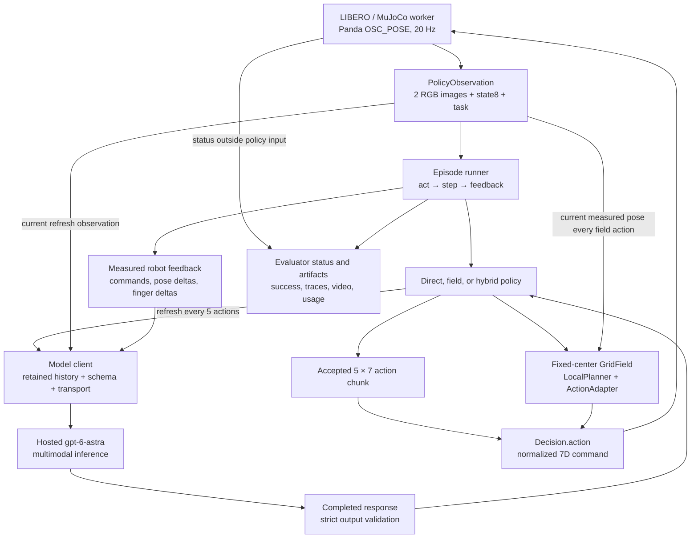
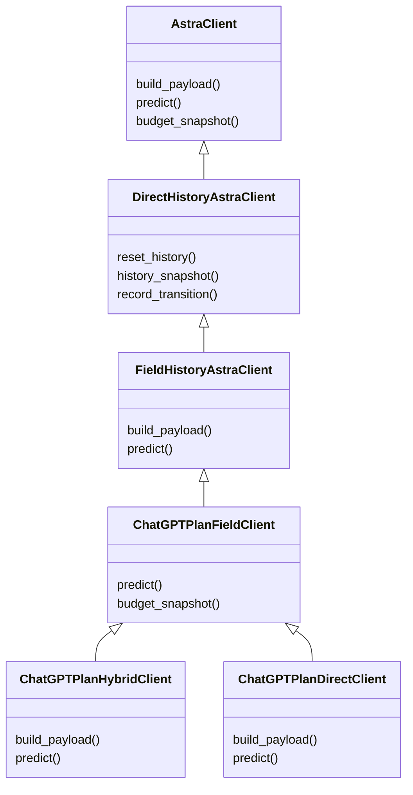

# Method, algorithms, and code/model architecture

Implementation snapshot: 2026-10-11.

This document explains how Astra's visual predictions become robot actions in the direct, field-only, and hybrid implementations. It focuses on the mathematical interfaces, algorithms, and software structure. Use [IMPLEMENTATION_PROTOCOL.md](IMPLEMENTATION_PROTOCOL.md) for environment setup, commands, and stopping rules, and [EVALUATION_REPORT.md](EVALUATION_REPORT.md) for measured outcomes, videos, and experimental limitations.

The system is an **inference-time controller built around a hosted multimodal model**. The repository does not train or fine-tune Astra, learn a dynamics model, or implement a neural distance-field network. In the field variants, Astra emits a discrete task-conditioned scalar potential; a deterministic local planner converts that potential into translation commands. In the direct variant, Astra emits the normalized robot commands itself. Hybrid control selects between these interfaces within one episode.

## 1. Method formulation

### 1.1 Observation, action, and two decision timescales

Let `o_t` be the allowed observation after `t` acknowledged actions and before issuing action `a_t`:

$$
o_t = (I_t^{ext}, I_t^{wrist}, s_t, \ell),
\qquad
s_t = [p_t, r_t, q_t^{finger}] \in \mathbb{R}^{8},
$$

where `p_t` is end-effector world position in meters, `r_t` is its three-component axis-angle orientation in radians, the last two entries are finger-joint positions, and `ℓ` is the task instruction. Each RGB image is 224 × 224 after preprocessing. This state is not the robot's full joint configuration or the target object's pose.

The simulator accepts

$$
a_t = [u_t^{xyz}, u_t^{rot}, g_t] \in [-1,1]^7.
$$

One action advances **0.05 simulated seconds** at 20 Hz. Translation components scale by 0.05 m; rotation components scale by 0.5 rad. Positive gripper commands close, negative commands open, and zero requests zero incremental gripper motion. A command is a controller target, not a guaranteed measured displacement.

There are two separate timescales:

- **Every action:** execute one command, acquire a new robot/image observation, and record the measured transition. Field mode also replans from that new robot state.
- **Every five actions:** submit a new visual request to Astra. For a normal uninterrupted run, refresh boundaries are `t_k = 5k`.

Simulation pauses while awaiting a model response. The resulting method is closed-loop across refreshes; it does not run the large model at a real-time 20 Hz inference rate. Within a direct-action chunk, the remaining commands are held fixed, while the simulator's OSC controller retains its ordinary low-level feedback.

Sources: [observation.py](src/gpt_field/observation.py), [action.py](src/gpt_field/action.py), [libero.py](src/gpt_field/libero.py).

### 1.2 A common model interface, three output representations

Write a model decision abstractly as

$$
z_k = f_\theta(H_k, o_{5k}; \mathcal{S}_m),
$$

where `H_k` is retained history before the current observation is appended, and `S_m` denotes the method-specific prompt and output schema. This notation describes inference; this repository does not update `θ`.

| Method | Structured output `z_k` | Action selection |
|---|---|---|
| Direct + history | `A_k ∈ [-1,1]^(5×7)` | Execute the five validated commands in order |
| Field-only + history | `F_k = (v_k, B_k, U_k, Q_k, G_k, M_k, stage_k)` | Search short translation paths in the field; adapt orientation and gripper intent |
| Hybrid + history | Routing envelope plus either `F_k` or `A_k` | Use the selected branch for the next five-action block |

For the field output, `v_k` contains 729 potential values; `B_k` and `U_k` are predicted blocked and unknown vertex indices; `Q_k` is a target quaternion; `G_k` is open/close/hold; `M_k` is move/hold. `stage_k` is a descriptive label, not executable phase logic.

The original `field` experiment is a separate condition: it uses the same field/control interface but supplies only the current observation to the model, without the later complete history and execution-feedback transcript. Likewise, the generic `FieldPolicy(method="direct")` path is not the later `DirectHistoryPolicy` baseline. Names should not be treated as interchangeable.

### 1.3 What the field represents

The field is a local task-conditioned preference over end-effector positions: **lower values are preferred**. Its values have arbitrary finite scale and no physical distance unit. The implementation does not enforce a goal value of zero, nonnegativity, metric axioms, an Eikonal equation, a Riemannian metric, or a signed-distance interpretation.

A field value therefore cannot establish “the gripper is 2 cm from the bowl.” The hybrid router also does not threshold field values to detect contact. Planning usefulness and metric distance fidelity remain separate research questions.

## 2. System and model architecture

### 2.1 Runtime data flow



The diagram shows the union of the three variants: a pure method uses one branch, and hybrid selects one branch at each refresh. The runner retains both the before and after observations to construct feedback; it never passes benchmark success into the policy or model history.

The policy process and simulator process communicate synchronously over newline-delimited JSON on stdin/stdout. `SimProcess` launches the worker using the specified simulation Python environment. Rendering, dynamics, contacts, and the official success predicate live in the worker; policy orchestration and model calls live in the project process. This separation also permits the project and simulator to use different dependency environments.

### 2.2 What “model architecture” means here

From this repository, Astra is a **hosted multimodal input/output boundary**:

```text
Method instructions + current RGB/state/task + retained transcript
                              ↓
                 Hosted Astra inference
                              ↓
          Completed structured JSON prediction
                              ↓
                  Local schema validation
```

The repository neither contains Astra weights nor reveals its internal visual encoder, transformer layer count, parameter count, or training architecture. Those internals are not inferred from the API. The field grid is serialized numeric model output, not an exposed neural tensor head, a local voxel network, or an additional trained model.

The same model identifier supplies direct actions, fields, and hybrid routing. Hybrid makes **one inference request** that returns both the mode choice and the chosen payload; it does not call separate planner, contact, router, and critic models. There is no second model checking history or grading success.

Recorded later episodes used `gpt-6-astra`; their response metadata resolved to `reasoning.effort=medium` and `service_tier=default`. The current configuration has no effort/tier CLI selector. These are recorded execution settings, not a description of Astra's neural internals. Details and evidence are in [the evaluation report](EVALUATION_REPORT.md).

### 2.3 Client inheritance versus policy composition

The **model clients** inherit transport, history, and request-building functionality:



Inheritance is software reuse, not a sequence of model invocations. For example, a hybrid prediction does not first request a direct action and then request a field. The leaf client assembles and submits the selected schema in one request.

The **policies** have a different structure:

| Policy | Actual relationship | Responsibilities |
|---|---|---|
| `FieldPolicy` | Owns `LocalPlanner`, `ActionAdapter`, active `GridField`, and a predictor client | Refresh field, search, adapt, return `Decision` |
| `DirectHistoryPolicy` | Standalone policy with a client and five-action queue | Exact direct-action execution and transition feedback |
| `FieldHistoryPolicy` | Subclasses `FieldPolicy`; aliases `DirectHistoryPolicy.observe_transition` | Preserve original field calculation while enforcing feedback/history continuity |
| `HybridFieldDirectPolicy` | Standalone class; composes `_FieldCache` and an original `FieldPolicy` | Reversible routing, direct queue, shared history and gripper intent |
| `_FieldCache` | Predictor-compatible local adapter; no network calls | Supply the already accepted hybrid field to the original `FieldPolicy` exactly once |

`HybridFieldDirectPolicy` explicitly calls `DirectHistoryPolicy.observe_transition(self, ...)`; it does not inherit from that policy. This reuses the same measured-feedback implementation while keeping hybrid routing separate. The direct subscription adapter is implemented, but the recorded standalone direct full-task evaluation used the API-key client.

Sources: [astra.py](src/gpt_field/astra.py), [direct_history.py](src/gpt_field/direct_history.py), [field_history.py](src/gpt_field/field_history.py), [chatgpt_plan.py](src/gpt_field/chatgpt_plan.py), [chatgpt_direct.py](src/gpt_field/chatgpt_direct.py), [hybrid_subscription.py](src/gpt_field/hybrid_subscription.py), [hybrid_policy.py](src/gpt_field/hybrid_policy.py).

## 3. History and feedback as controller state

### 3.1 Transcript lifecycle

Before a model refresh, the client assembles the previous transcript and the current observation. After a complete, schema-valid response, it commits that observation and the exact accepted output items to local history. After each acknowledged simulator action, it appends measured feedback as a user input message.

```text
observation at action boundary 0
accepted model output for actions 0–4
feedback for action 0
feedback for action 1
feedback for action 2
feedback for action 3
feedback for action 4
observation at action boundary 5
accepted model output for actions 5–9
...
```

All textual observations, accepted outputs, and feedback remain. Only the latest **two model-observation image pairs** are retained as images; earlier image content is replaced with omission markers. These are not the latest two simulator steps. Images acquired between model refreshes remain in the execution artifacts but are not separate visual model turns.

Ordered accepted output items, item IDs, and assistant phase are preserved. Encrypted reasoning items are retained only as opaque protocol data, without interpretation or rendering. Requests use `store=false`; local transcript state supplies the history. Invalid/incomplete outputs do not become executable accepted turns.

This is inference-time context, not gradient-based learning, reinforcement learning, or a reward update. The client ledger persists separately from episode history; resetting history does not erase accounted usage.

### 3.2 Measured feedback

For one acknowledged transition `(o_t, a_t, o_(t+1))`, the shared code computes

$$
\Delta p_t^{cmd}=0.05\,u_t^{xyz},\qquad
\Delta p_t^{obs}=p_{t+1}-p_t,
$$

$$
e_t=\|\Delta p_t^{obs}-\Delta p_t^{cmd}\|_2,
\qquad
\Delta q_t^{finger}=q_{t+1}^{finger}-q_t^{finger}.
$$

The record also includes before/after state8, the executed action, desired world rotation `0.5 u_t^rot`, translation norms, and global/chunk indices. It does not separately compute measured rotational tracking error.

A rolling window of at most 25 actions reports commanded and measured path lengths, measured net translation, and close/low-motion counts. A translation command has norm at least 0.001 m; it is classified as low motion when realized translation is at most 0.0001 m. These statistics inform the next model request. They do not automatically rewrite an action, trigger recovery, verify a grasp, or supply task reward.

### 3.3 Decision/acknowledgment invariant

History-aware policies maintain `_pending = (before_observation, Decision)`. They reject another `act()` until `observe_transition()` receives that exact decision object and matching before observation. The next action must use an observation equal to the preceding recorded after observation. Hybrid synchronizes executed nonzero gripper intent across controllers after valid feedback succeeds. The original field adapter also updates its own remembered open/close intent while constructing a coarse decision; that internal update alone is not simulator acknowledgment.

In code, `step_index` advances when a decision is created; acknowledgment is tracked separately. A proposed or execution-marked action is therefore not automatically an executed action. The runner counts it as executed only after `sim.step()` returns. If acknowledgment fails, execution is interrupted and pending state is preserved instead of inventing a completed transition.

Sources: [DirectHistoryPolicy.observe_transition](src/gpt_field/direct_history.py), [FieldHistoryPolicy](src/gpt_field/field_history.py), [HybridFieldDirectPolicy](src/gpt_field/hybrid_policy.py).

## 4. Algorithm A: common execution loop

The following pseudocode uses `t` for acknowledged actions. It abstracts artifact writes and exception handling without changing the information supplied to the policy.

```text
initialize model client, policy, simulator, trace writer, and video recorder
policy.reset()
o ← simulator.reset(task_id=0, initial_state=0)
t ← 0
record initial observation and evaluator status

while evaluator has not observed success:
    decision ← policy.act(o)
    record proposed decision and its field/plan/chunk diagnostics
    mark action t as awaiting simulator acknowledgment

    o_next, success ← simulator.step(decision.action)
    record acknowledged action, o_next, and evaluator-only status
    t ← t + 1

    feedback ← policy.observe_transition(o, decision, o_next)
    record feedback and post-action video event
    o ← o_next

    if success:
        finalize successful episode
        stop before any further policy/model action

on user stop, budget denial, invalid model output, or infrastructure error:
    preserve acknowledged prefix, pending information, usage, and terminal reason
    finalize as incomplete rather than fabricate success or unexecuted actions
```

This describes the later full-task history runners. The original finite-horizon batch additionally stops at its declared action limit. The first-close subscription diagnostic adds an explicit stop after an acknowledged positive gripper command; it is not the full-task algorithm. LIBERO status is consumed by the runner and not passed to `policy.act()` or the feedback schema.

Entry points: [direct runner](scripts/evaluate_bowl_direct_history.py), [field-history runner](scripts/evaluate_bowl_field_history.py), [hybrid runner](scripts/evaluate_bowl_hybrid_subscription.py).

## 5. Algorithm B: direct action generation

At refresh `k`, Astra returns exactly five normalized actions. Execution is

$$
a_{5k+j}=A_k[j], \qquad j\in\{0,1,2,3,4\},
$$

unless evaluator success or interruption ends the block early.

```text
DIRECT_ACT(o):
    require no unacknowledged decision and continuity with previous observation
    if action queue is empty:
        A ← client.predict(o, mode="direct")
        validate exactly 5 × 7 finite values within [-1, 1]
        queue ← A
    action ← remove first action from queue
    create Decision(action, chunk/history diagnostics)
    register pending decision
    advance policy.step_index by one
    return Decision
```

No field, local trajectory search, field rotation cap, forced closure, or stagnation override participates. The model may coordinate translation, rotation, and gripper commands in each action and choose different magnitudes within the normalized bounds. The method's flexibility is one difference from field planning, beyond the output representation itself.

The shared feedback is collected after each action, but it influences a new model decision only when the chunk is exhausted. A sequence of valid zero-arm commands remains zero-arm execution until the model changes it or the runner stops.

Source: [direct_history.py](src/gpt_field/direct_history.py).

## 6. Algorithm C: field generation and local planning

### 6.1 Spatial representation

At refresh boundary `5k`, define field center `c_k = p_(5k)` and grid nodes

$$
\xi^{(k)}_{ijr}=c_k+0.02\,[i-4,j-4,r-4],
\quad i,j,r\in\{0,\ldots,8\}.
$$

Here `k` is the refresh index and `r` the z-grid index. In code, flattening is `81*i + 9*j + r`. The cube has a 0.16 m side length, extending 0.08 m along each axis from its center. Its axes are world aligned, not rotated with the wrist.

The center stays fixed for the five-action block. Actual robot motion changes the query position, not the meaning of previously generated grid values. Reinterpreting old values around each new robot pose would create a different and incorrect algorithm.

For a query point `x`, convert to lattice coordinates

$$
u = \frac{x-(c_k-0.08\mathbf{1})}{0.02}.
$$

For each cell, trilinear interpolation computes

$$
V_k(x)=\sum_{b\in\{0,1\}^3}v_{l+b}
\prod_{d=1}^{3}\left[b_d f_d+(1-b_d)(1-f_d)\right],
$$

where `l=floor(u)` and `f=u-l`, with special handling at grid boundaries. Only corners with nonzero weights participate. The code snaps lattice coordinates within `1e-10` of a grid coordinate and tolerates corresponding boundary roundoff.

Any active blocked/unknown corner makes the query invalid. Out-of-grid queries and nonfinite interpolation results are also invalid. The implementation checks finite values even at masked vertices. It applies no potential normalization, gradient extraction, or metric conversion.

For a candidate segment, `segment_valid()` checks its endpoints, all intersections with grid planes, and one midpoint in each intervening interval. These intervals have fixed interpolation stencils, so this tests every stencil traversed by the segment. It certifies only consistency with the predicted masks, not actual robot-link or object collision clearance.

Sources: [GridSpec and FieldPrediction](src/gpt_field/schema.py), [GridField](src/gpt_field/field.py).

### 6.2 Candidate trajectories and objective

The ordered primitive set is

$$
\mathcal{D}=0.01\{+e_x,-e_x,+e_y,-e_y,+e_z,-e_z\}\quad\text{meters}.
$$

From the **current measured** position `p_t`, enumerate a horizon-three sequence `d_1,d_2,d_3` and its predicted waypoints

$$
\hat p_j=p_t+\sum_{i=1}^{j}d_i, \qquad j=1,2,3.
$$

There are `6^3 = 216` nominal sequences, each of commanded path length 0.03 m. Reject adjacent immediate reversals, waypoints outside workspace `[-1,-1,0]` to `[1,1,1.5]` m, and invalid field segments. Reversal filtering alone leaves 150 sequences before the remaining constraints. This is a kinematic geometric rollout; it does not predict controller lag, joint trajectories, contact forces, or object motion.

Selection is a tolerance-aware lexicographic rule:

1. Find the minimum terminal potential `V_k(p̂_3)`.
2. Retain terminal values within `ε_V` of that minimum; among them find the minimum immediate potential `V_k(p̂_1)`.
3. Retain immediate values within `ε_V` of the second minimum; choose the smallest primitive-index sequence in the fixed axis order.

The tolerance is

$$
\epsilon_V=64\,\epsilon_{float64}\,
\max_{i\in\mathrm{valid\ vertices}}|v_i|.
$$

Masked placeholders do not set the tolerance, and there is no unit-dependent floor. The planner does **not** minimize an integrated path cost, a weighted combination of travel and potential, or a learned trajectory score. Equal nominal travel length is built into the search space. `V(p̂_2)` does not contribute to ranking, although the second segment must still be valid.

Execute only the first selected primitive `d_1`. Compute predicted improvement `V_k(p_t) − V_k(p̂_3)` for logging: status is `move` only if this exceeds `max(plateau_tolerance, ε_V)`, otherwise `plateau_move`. Default `plateau_tolerance` is zero. A plateau does not suppress the chosen motion.

An explicit `motion_mode="hold"` returns zero translation before candidate search. An invalid start or no valid candidate also returns zero translation. These cases still pass through orientation and gripper adaptation.

Source: [LocalPlanner.plan](src/gpt_field/planner.py).

### 6.3 Orientation and gripper adaptation

Let `R_t` be measured end-effector orientation and `R*` the model's target. The adapter computes the shortest world-frame orientation error corresponding to

$$
R_{err}=R^*R_t^\top.
$$

It converts that error to a rotation vector, caps its norm at 0.15 rad, and produces

$$
a_t=\left[\frac{d_1}{0.05},\frac{\operatorname{cap}_{0.15}(\operatorname{rotvec}(R_{err}))}{0.5},g_t\right].
$$

The implementation uses quaternion multiplication, flips the error quaternion sign when necessary for the shortest rotation, and normalizes the target after schema validation. The schema permits target-quaternion norm error at most 0.001. Translation components beyond `0.05 + 1e-12` m are rejected before the final numerical `[-1,1]` clip.

For field commands, `open` sets remembered grip intent to `-1`, `close` sets it to `+1`, and `hold` repeats the remembered value, initially `-1`. Field `hold` is therefore not direct gripper value `0`. A standard 1 cm axis primitive becomes a normalized translation command of `±0.2`.

The planner searches translation only. Astra's orientation and gripper outputs are applied separately; there is no joint optimization over position, orientation, fingers, and contact state.

Source: [ActionAdapter.adapt](src/gpt_field/action.py).

### 6.4 Field control pseudocode

```text
FIELD_ACT(o, global_action_index):
    if global_action_index mod 5 == 0:
        prediction ← client.predict(o, mode="field")
        validate prediction
        field ← GridField(default_grid, center=o.position, prediction)

    if prediction.motion_mode == "hold":
        delta ← [0, 0, 0]
    else if starting position is invalid in the workspace or field:
        delta ← [0, 0, 0]
    else:
        candidates ← enumerate 216 three-step sequences from o.position
        reject reversals, workspace violations, and invalid field segments
        if no valid candidate:
            delta ← [0, 0, 0]
        else:
            sequence ← terminal/immediate/axis-order selection with ε_V ties
            delta ← first primitive of sequence

    action ← adapter.adapt(delta, prediction.orientation,
                           prediction.gripper, o.state8)
    advance the field policy action index by one
    return Decision(action, prediction/field/plan diagnostics)
```

`FieldHistoryPolicy` wraps this original calculation with the shared pending-action and feedback checks; it does not replace the planner. The physical trajectory is the sequence of **measured** positions. The candidate paths are short geometric predictions that are rebuilt after each actual step, not a single precomputed trajectory to the bowl.

For illustration only, if a valid local field is `V(x)=−x_world`, orientation already matches the target, and grip intent is open, a selected `+x,+x,+x` plan yields `[0.2,0,0,0,0,0,-1]` for its first action. If that action realizes only 2.5 mm, the next plan starts 2.5 mm from the old start, not 10 mm. The held field center remains unchanged until the next refresh. This example explains the algorithm and is not an additional Astra experiment.

## 7. Algorithm D: hybrid field/direct control

### 7.1 Routing contract

A hybrid response contains exactly:

```text
controller:     "coarse_field" or "contact_direct"
target_region:  "black_bowl" or "plate"
near_target:    boolean
routing_reason: brief nonempty explanation
field:          field prediction or null
direct:         {actions: five normalized 7D commands} or null
```

Validation requires `near_target=false` in coarse mode and `true` in direct mode, with only the matching payload populated. These checks enforce internal consistency of the model response; they do not verify physical proximity.

The prompt asks for field planning during free-space approach/transport and direct control near the active interaction region for alignment, grasping, lift clearance, placement, or release. `near_target` is a model judgment based on the allowed views, robot state, and history. There is no hidden object-distance threshold, field-value threshold, or contact sensor used for routing.

### 7.2 One model decision, one active branch

```text
HYBRID_ACT(o):
    require no pending action and exact observation continuity
    t ← global policy action index

    if t mod 5 == 0:
        envelope ← client.predict(o, mode="hybrid")
        validate routing and active payload
        controller ← envelope.controller
        if controller == "coarse_field":
            field_cache.prepare(o, envelope.field)
            clear direct queue
        else:
            direct queue ← envelope.direct.actions

    if controller == "coarse_field":
        original_field_policy.step_index ← t
        decision ← original_field_policy.act(o)
        # Its refresh consumes the cached field; no second model request occurs.
    else:
        decision ← Decision(next unchanged direct action)

    attach controller, routing, history, and global chunk diagnostics
    register the pending decision
    advance the hybrid policy.step_index by one
    return decision

HYBRID_OBSERVE_TRANSITION(before, decision, after):
    feedback ← shared DirectHistoryPolicy.observe_transition(...)
    if executed gripper value is nonzero:
        field adapter's remembered intent ← sign(executed gripper value)
    return feedback
```

Both controllers retain one shared transcript, global step counter, 25-action feedback window, and last nonzero grip intent. A direct zero gripper action executes as zero without erasing the intent used by a later field `hold`.

Switching is reversible at five-action boundaries. Returning to field mode requires a newly generated field centered at the current observation; the old pre-contact field is not reactivated. In direct mode, the policy's public `field` property is `None`. Independently, `HybridVideoRecorder.decision` clears its rendered field and local-plan state, preventing a stale coarse field from being displayed as the current plan.

A possible trajectory is field approach → direct grasp retries → field transport → direct placement. It is not a programmed phase sequence. The recorded hybrid episode chose that pattern, but the code does not force it, automatically close the gripper, or trigger recovery from a stage label.

Sources: [hybrid schema and prompt](src/gpt_field/hybrid_subscription.py), [hybrid orchestration and cache](src/gpt_field/hybrid_policy.py).

## 8. Code map and execution boundaries

| Layer | Module / principal definitions | Responsibility |
|---|---|---|
| Observation | [observation.py](src/gpt_field/observation.py): `PolicyObservation` | Image conversion, state8 construction, strict allowed-input boundary |
| Prediction schema | [schema.py](src/gpt_field/schema.py): `GridSpec`, `FieldPrediction` | Field geometry, auxiliary command validation, masks and finite values |
| API client | [astra.py](src/gpt_field/astra.py): `AstraConfig`, `AstraClient` | Request schema, API-key transport, response extraction, accounting |
| History/direct control | [direct_history.py](src/gpt_field/direct_history.py) | Transcript retention, direct chunks, exact transition feedback |
| History/field control | [field_history.py](src/gpt_field/field_history.py) | History prompt with unchanged `FieldPolicy` action calculation |
| Subscription access | [chatgpt_auth.py](src/gpt_field/chatgpt_auth.py), [chatgpt_plan.py](src/gpt_field/chatgpt_plan.py) | Separate account authorization and complete SSE response transport |
| Direct subscription adapter | [chatgpt_direct.py](src/gpt_field/chatgpt_direct.py) | Reuse the direct prompt/schema with subscription transport |
| Hybrid model interface | [hybrid_subscription.py](src/gpt_field/hybrid_subscription.py) | Routing envelope, prompt, schema validation, subscription prediction |
| Hybrid policy | [hybrid_policy.py](src/gpt_field/hybrid_policy.py) | Branch selection, original planner composition, shared gripper memory |
| Field evaluation | [field.py](src/gpt_field/field.py): `GridField` | Fixed-center interpolation and predicted-mask segment validity |
| Discrete search | [planner.py](src/gpt_field/planner.py): `LocalPlanner`, `PlanResult` | Candidate enumeration, ranking, first move, full diagnostics |
| Action adaptation | [action.py](src/gpt_field/action.py): `ActionAdapter` | Field orientation/translation conversion and grip intent |
| Original policy | [policy.py](src/gpt_field/policy.py): `FieldPolicy`, `Decision` | Model-refresh cadence and composition of field/planner/adapter |
| Simulator bridge | [libero.py](src/gpt_field/libero.py): `SimProcess`, `_LiberoWorker` | JSON process protocol, benchmark reset/step, controller checks, evaluator status |
| Episode drivers | [direct](scripts/evaluate_bowl_direct_history.py), [field](scripts/evaluate_bowl_field_history.py), [hybrid](scripts/evaluate_bowl_hybrid_subscription.py) | Configure, execute, acknowledge, log, stop, finalize |
| Rendering and audit | [hybrid_video.py](src/gpt_field/hybrid_video.py), [audit_hybrid_subscription.py](scripts/audit_hybrid_subscription.py) | Recorded visual explanation and independent artifact consistency checks |

The core policy package uses NumPy and Pillow; the simulator uses the separately configured LIBERO/robosuite/MuJoCo environment. Local GPU computation is used by the simulator/rendering environment as configured, not to host Astra weights. The subscription extra adds OAuth token-validation support. Dependency declarations are in [pyproject.toml](pyproject.toml).

The API-key and subscription clients share method-level contracts but have different access/accounting behavior. Subscription streaming executes nothing from partial output: completion and schema validation must succeed first. It has no silent API-key or model fallback. These transport differences do not change coarse-field interpolation or planning math, but they remain experimental differences in comparisons.

## 9. Artifacts, verification, and performance implications

### 9.1 Data products

| Product | Contents | Appropriate interpretation |
|---|---|---|
| `PolicyObservation` | Two image data URLs, state8, task | Information permitted to influence policy |
| Accepted prediction | Field, direct chunk, or hybrid envelope | Model-selected control representation |
| `GridField` | Grid specification, generation center, values/masks/auxiliaries | Local predicted potential at a fixed origin |
| `PlanResult` | Candidates, rejection reasons, selected index, first delta, predicted improvement | Inspectable local geometric search |
| `Decision` | Executable action and diagnostics | Proposed command; execution requires simulator acknowledgment |
| Execution feedback | Exact command and measured before/after robot changes | What the controller actually realized, without object or reward oracle |
| Run artifacts | Manifests, request/response records, traces, status, video, usage | Reproducibility and outcome evidence; not all are policy inputs |

The annotated video displays these intermediate products. A separate initial `OBSERVE` event is followed by post-action observations inside execution events. A highlight appearing once does not imply a single observation for the whole episode. Videos omit model waiting time and slow selected events for readability.

The artifact auditor reconstructs histories, recalculates coarse plans, checks exact direct-action slices and feedback, and reconciles provenance, usage, and video chronology. This is offline verification, not another model critic or another scored rollout. Separate evaluator-only physics replays may inspect hidden object/contact state; that diagnostic path is outside the policy input boundary.

### 9.2 Computational implications

Field storage and numeric output scale as `n^3` grid samples; the current `n=9` produces 729 values per field. Discrete candidate enumeration scales as `6^h`; current horizon `h=3` produces 216 nominal sequences before rejection. Each candidate also requires segment-validity queries. This explains why increasing grid resolution or horizon changes both representation cost and local work.

Every five actions, direct control emits 35 action scalars, while a field emits 729 potential scalars plus auxiliary commands and masks. Output size alone does not determine model quality or latency, but it affects the amount of data retained and resent.

With complete uncompressed textual history and approximately constant new text per refresh, prompt length grows approximately linearly in the number of refreshes, and cumulative resent input grows approximately quadratically. This is a scaling argument, not a measured runtime law; image retention, varying outputs, caching, and context limits affect actual usage. The present implementation prunes old images but does not summarize old textual fields or feedback.

### 9.3 Verification map

Existing tests cover distinct contracts:

- [Field tests](tests/test_field.py), [planner tests](tests/test_planner.py), and [adapter tests](tests/test_action.py): interpolation/masks, candidate selection, numerical ties, physical scaling, and gripper semantics.
- [Direct history tests](tests/test_direct_history.py) and [field history tests](tests/test_field_history.py): output/history retention, image pruning, measured feedback, pending decisions, and original field-action parity.
- [Hybrid policy tests](tests/test_hybrid_policy.py) and [client tests](tests/test_hybrid_subscription.py): routing validation, fresh field centers, exact direct commands, branch transitions, and grip memory.
- [Runner tests](tests/test_hybrid_subscription_runner.py), [video tests](tests/test_hybrid_video.py), and [artifact auditor](scripts/audit_hybrid_subscription.py): termination, acknowledged-action bookkeeping, evidence presentation, and recorded execution consistency.

This document was prepared from code and existing artifacts; it does not add a new controller or evaluation result.

## 10. Interpretation and extension boundaries

The method is best described as **task-conditioned potential prediction with finite discrete receding-horizon kinematic search**, augmented by direct model control near model-selected interaction regions. Its short predicted paths are not shortest-path guarantees, Riemannian geodesics, full-arm collision-free trajectories, or contact-dynamics optimization.

Three design questions remain experimentally separate:

1. Does history and measured feedback improve state/progress tracking?
2. Does the field representation and local search improve coarse planning relative to simpler representations or direct actions?
3. Does switching to more expressive direct actions improve contact manipulation?

Current code provides interfaces for investigating these questions, but the existing runs change more than one factor. A new controller, contact sensor, success/reward input, memory summary, action primitive set, or release-and-settle criterion should have its own recorded configuration and comparison. The related results and limitations are documented in [EVALUATION_REPORT.md](EVALUATION_REPORT.md).
