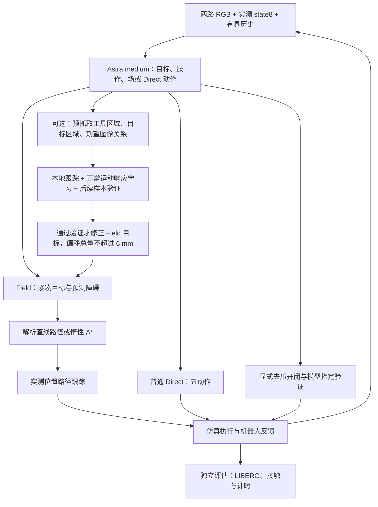

# GPT Field 测试历史与分析

> 整理日期：2026-10-15（UTC）。本报告根据项目内保存的配置、请求、终止摘要、审计和分析文件整理；按方法演进顺序组织，不把不同分支的编号当作统一版本号。原始日志中的 UTC 时间戳保持原样。最新完整任务为 `contact_region_drawer_zero_shot_001`，已按用户指示停止；本文编写没有启动新模型请求、仿真任务或重试。

## 阅读范围与核心问题

项目的目标是让 GPT 充当机器人策略时，通过**紧凑场表示、本地运动规划和连续执行**减少模型调用及总控制时间，同时减少无效尝试和恢复。研究对象是可推广的方法，而非为碗或抽屉写死坐标、固定脚本或成功轨迹。

真实任务主要包括：原布局碗放盘、新布局碗放盘、替换干扰物并增加路径障碍的碗场景，以及“打开上层抽屉并把碗放入”。测试包含零示范、单示范、完整任务、有限局部诊断和历史数据离线回放。它们的终点和证据强度不同，本报告分开记录。

需要回答的核心问题是：

1. 场能否减少 GPT 请求，同时保持或提高真正完成任务的概率？
2. 收益来自场与规划本身，还是来自动作批量执行、轨迹跟踪、历史压缩、示范或夹爪操作？
3. 失败发生在目标识别、空间目标估计、路径可达性、执行跟踪、抓取/放置，还是完成判定？
4. 新模块是否实际运行？“已实现”“离线测试通过”和“本轮任务改善”不能互相替代。

本报告以保存的终止结果为准。`AGENTS.md` 和 `README.md` 保留了部分当时的运行中描述；与后来的终止摘要冲突时，不采用旧的“正在运行/尚未测试”作为当前结论。没有可靠记录的量记作 `-`，不从视频长度或目录名称推算。

## 结论速览与阅读导航

**历史上确实完成过任务，也测到过时间节省；但当前方法尚未证明在零示范、多布局和障碍条件下稳定优于 Direct。** 后续失败并不都发生在同一阶段：有的没有有效 Field，有的到达了错误的接触目标，有的成功抓起后掉落，有的仍在搬运时由用户停止。下文保留这些差别。

| 可核对的关键事实 | 结果与解释 |
|---|---|
| 同提示 Compact 碗配对（fair 004） | 两边 LIBERO 成功；扣录像 Hybrid 391.04 s、Direct 415.42 s，少 5.87%；此前三次 Hybrid 中断也保留 |
| 早期 Distance、一示范原始碗 | 两边成功；176.97 vs 237.78 s，少 25.57% |
| 早期 Distance、一示范新布局碗 | 两边成功；215.76 vs 220.03 s，少 1.94%，仅 4.27 s 的单次差异 |
| 早期 Distance、一示范原始抽屉 | 两边成功；836.70 vs 997.30 s，少 16.10% |
| 障碍场景的一示范配对 | 原始 LIBERO 为真，但两边碰 ketchup 瓶，按该轮无碰撞要求均失败 |
| Speed-first v2/v3 原始碗 | 有真实成功，也有同版本重复未完成；新增局部视觉纠偏在成功轮未启用 |
| 最新 Contact-region 抽屉 | 697 动作、41 响应后用户停止，LIBERO=false；净耗时1122.85 s；抽屉已开、碗仍在桌上；新增参考与实际纠偏均为0 |

这些数值的逐轮来源、失败重试和协议差异均列在相应正文中。不同历史版本的成功耗时不能直接组成无偏排行榜，未完成耗时不能混入成功速度比。

阅读顺序：

- [评价口径](#evaluation-protocol)：成功、碰撞、停止、录像与公平性。
- [方法与架构](#method-architecture)：势场与距离场定义、规划和实际动作的区别。
- [早期实验与 Direct 对照](#early-experiments)：API 探索、订阅 Dense/Compact、Distance、zero/one-shot、布局和障碍。
- [Visual Field v1–v36](#visual-field-history)：逐轮记录、局部闭环与执行门槛的演进。
- [Speed-first 到操作级方法](#recent-experiments)：重复测试、1 mm、高分辨率、机器人几何、身份、记忆和预抓取。
- [最新 Contact-region 完整测试](#latest-contact-region)：离线验证、实际激活情况和终止分析。
- [跨版本判断与待验证问题](#cross-version-analysis)：证据支持什么、还不能支持什么。
- [后续实验建议](#next-experiments)：尚未执行的验证顺序。

<a id="evaluation-protocol"></a>

## 必须统一的评价口径

### 成功、停止与失败分别是什么

| 状态 | 含义 | 可以当作完成任务的耗时吗 |
|---|---|---|
| raw LIBERO success | 仿真任务原始目标谓词为真 | 可以，但还要核对该轮是否另有零碰撞要求 |
| 模型自判完成 | Astra 根据图像/历史认为任务完成 | 仅能作当时 OR-stop 协议的终点，不能替代 LIBERO 成功 |
| 碰撞失败 | 按该组最终约定的无碰撞标准，接触记录或视频复核确认禁止接触 | 不可以；即使 raw LIBERO 同时为真，也不算该协议成功 |
| 用户停止 | 用户明确提前结束，尚未达到完成条件 | 不可以；记录的是未完成运行成本 |
| 服务/基础设施错误 | 订阅过载、通信或本地实现异常导致中断 | 不可以；单独报告中断原因，不能据此等同于完整策略任务失败或成功 |
| 局部诊断上限 | 有限动作、请求或尝试范围内未达到局部指标 | 仅代表该诊断终点，既不是完整任务成功，也不证明没有任何物理进展 |
| 离线/合成测试通过 | 检查数学、代码、接口或保存的 RGB 行为 | 不可以；没有测量新动作对任务的真实效果 |

LIBERO 的任务谓词与“动作数/时间是否超限”应分开理解。这里多轮调试按用户要求**没有整轮时间或动作上限**，所以不等同于带统一步数预算的正式基准评测。抽屉任务还包含把碗放入；仅拉开抽屉不等于任务成功。是否需要松爪、额外稳定等待等，以实际任务谓词和该轮约定为准，不用人类观看视频的直觉改写历史成功标签。

后期 Speed-first 的碰撞协议已经改为 **record-only**：允许继续执行、单独统计碰撞，仍以 raw LIBERO 成功作为完成。此前障碍实验要求零碰撞，其失败结果不能用后期宽松规则追溯改成成功。

### 时间口径

主要比较量为：

```text
T_net = control_elapsed_s - timing_components.video_render_s
```

它保留模型推理与等待、本地规划/视觉、仿真步进和控制循环其他开销；扣除被计量的同步录像开销。初始化、历史动作重放和最终视频编码应按各实验定义另列。直接减去已测录像时间，并不能精确重建“当初完全关闭录像”时的 CPU 竞争和服务调度。

**视频播放时长不是控制墙钟时间。** 视频按仿真帧/固定帧率播放，模型思考和网络等待通常不会以同样时长编码进去。早期“视频约 2:30、报告约 10:59”的差异不能据此判定计时错误。

只有同条件下两边都达到约定成功终点，才能计算完成时间减少比例：

```text
减少比例 = (T_Direct - T_Hybrid) / T_Direct
```

一边用户停止或服务中断时，只保留耗时和删失状态，不把有限等待时间当作完成时间。多次重试后选出的成功单轮，也不能忽略此前失败成本而宣称稳定加速。`decision_s`、`model_pipeline_s`、`local_planning_s` 等可能是嵌套计时，不应不经检查直接相加。

计时来源：[统一扣录像对照](runs/current_hybrid_direct_no_video_comparison_001/comparison.json)、[当前任务原始摘要](runs/contact_region_drawer_zero_shot_001/trial/summary.json)。

### 输入与公平性约束

- 后期统一使用 **gpt-6-astra / medium / ChatGPT 订阅 OAuth**；`api_calls` 是历史字段名，包含订阅推理请求，并不等于 API-key 计费。是否符合订阅要求看 `billing`、`subscription_inference_calls` 和 `api_key_calls`。
- 较早的 API-key 基线保留作历史，但不是后续订阅实验的同条件 Direct 对照；订阅故障不切换 API key 或模型。
- 策略输入主要为外部相机与腕部相机 RGB、8D 机器人状态。用户允许机器人关节反馈，但最新实际运行仍是 state8；没有因此自动启用完整关节反馈。
- 不提供深度、环境相机标定、真实物体位姿或隐藏成功判据。仿真接触/物体运动等仅用于独立评估，不能反馈给策略。
- 普通 Direct 保持一次五个模型动作。后期显式夹爪操作、验证动作不是普通 Direct5，报告时应独立计数。
- 单示范输入是上下文参考，不是微调，也没有一个可解释为“示范占多少百分比”的固定控制权重。参考动作不会自动重放到测试环境。
- OOD 场景保留任务对象/目标，但改变布局或干扰物。原布局单示范成功并不能证明 OOD 障碍泛化。
- 最新完整任务需事先获得用户批准；本次记录已停止，没有新的任务队列或自动重试。

<a id="method-architecture"></a>

## 架构演进与场的准确含义

### 从 Dense Field 到 Compact Field

最早让 GPT 直接生成网格顶点的势值；随后按用户选择，把网格间距改为 5 mm、保留 16 cm 覆盖，即 `33×33×33 = 35,937` 个顶点。若每次由语言模型逐项生成，输出成本明显增加，因此改为紧凑参数：

- 相对当前末端的目标偏移 `goal_offset_m`；
- 目标吸引各轴权重；
- 最多四个高斯排斥项；
- `blocked_boxes`、`unknown_boxes`；
- 目标姿态、夹爪命令及运动/阶段信息。

本地按这些参数生成/查询场。令 `x` 是相对建场中心的位置、`g` 是目标偏移，早期 Compact 势函数为：

```text
U(x) = sqrt(Σ_j a_j ((x_j - g_j) / 0.08 m)^2)
       + Σ_k w_k exp(-||x - c_k||² / (2 σ_k²))
```

阻塞/未知盒通过有效性掩码单独处理；高斯排斥项本身不会自动变成硬碰撞边界。这个 `U` 是**越低越优的任务势值**，并非到最近物体表面的 signed distance，也不天然具有“数值就是米”的距离含义。[Compact 实现](src/gpt_field/compact_field.py)

### 从固定长度搜索到 cost-to-go

早期规划器在六个轴向运动原语上搜索等长局部轨迹。最初三步、每步 1 cm；后来扩为十步。`6^10` 是原始序列数量，不意味着每轮实际存储了六千多万条独立轨迹；实现对等价格点状态进行精确合并，最终选择一条路径执行。随后加入可提前结束的解析目标路径与实测位置跟踪。[早期规划器](src/gpt_field/planner.py)

Distance Hybrid 引入了与上述势值不同的**离散到目标代价**：

```text
ρ(x) = 1 + Σ_k w_k exp(-||x - c_k||² / (2 σ_k²))
edge_cost(i,j) = ||x_i - x_j|| × (ρ(x_i) + ρ(x_j)) / 2
D(i) = 从 i 到目标区域的最小累计 edge_cost
```

当前加权距离的边代价不使用 `attraction_weights`；该字段保留在兼容接口及势值展示中，不能将其混入下面的距离最优性解释。

5 mm 版本在预测有效的 26 邻接图上用 Dijkstra 求解并缓存；排除阻塞/未知区域，检查对角穿角与连续盒相交。无排斥且直线路径有效时，可直接得到到目标区域的欧氏最短路径。`ρ=1` 时图路径代价有米的量纲；加入排斥后是加权米。最优性限于**给定预测图/代价**，不等于真实环境的最短无碰撞路径，也不是连续 Eikonal 方程或论文测地场的完整实现。[距离规划器](src/gpt_field/distance_planner.py)

后期 1 mm 版本保留 16 cm 覆盖，逻辑顶点数为 `161³ = 4,173,281`。它使用惰性场查询与按需 A*，不逐轮分配四百多万个势值和完整图。有效直线仍走解析分支；只有确实需要时才搜索 26 邻接图。因此“1 mm 网格存在”不意味着这一轮实际做了障碍图搜索，或拥有 1 mm 真实空间感知精度。[细网格规划器](src/gpt_field/fine_distance_planner.py)

视频恢复颜色显示后，色彩主要帮助查看场/距离切片。颜色密度、插值或更细网格本身不能证明空间预测更准确，惰性规划也不能伪装成已求解整个稠密距离体。

### 规划长度、动作步数、模型更新间隔是三个量

| 参数 | 典型含义 | 不能直接推导的量 |
|---|---|---|
| 网格间距 5 mm / 1 mm | 场表示与图搜索的空间采样 | 机器人每动作一定移动该距离 |
| 最多十个、每段不超过 1 cm 的路径段 | 一次提取的局部几何路径，上限约 10 cm | 一定执行十个完整 1 cm 位移 |
| 最多十个控制动作的局部跟踪 | 从当前真实状态追踪路径，可能提前到达或停滞 | 每个动作与一个几何节点一一对应 |
| 通常最多 30 个 Field 动作后刷新 GPT | 模型调用间隔上限之一 | 实际走了 30 cm，或每次一定凑满 30 步 |
| 普通 Direct 五动作 | 一次输出五条归一化机器人命令 | 总位移等于 5 cm |

姿态、夹爪、接触阻挡和控制器响应都会使实测位移不同于命令位移。后续版本允许到达、失效、边界或无进展时提前刷新；部分版本还允许有条件扩展复用预算。局部预算耗尽是请求新模型判断的事件，不等于整轮任务终止。[距离策略](src/gpt_field/distance_policy.py)、[轨迹跟踪器](src/gpt_field/tracking.py)

### 当前操作级架构



操作类型明确区分 `move`、`pregrasp`、`grasp_close`、`verify_grasp`、`transport`、`place_align`、`release`、`articulate`、`recover`、`direct`。GPT 选择操作/目标和预期结果；本地执行器管理动作预算、轨迹跟踪、明确要求的夹爪稳定与验证动作，持续状态记录“模型声称”与“实测反馈”。评估器的隐藏物体状态和成功信号不作为下一轮策略输入。[操作协议](src/gpt_field/operation_contract.py)、[操作级策略](src/gpt_field/speed_first_v4.py)

区域反馈只在适用的预抓取意图与有效参考下学习。目标关系错误、参考为空或动作没有激励出有效方向时，局部算法不会自动获得真实接触几何。当前实现能够执行有界修正，但最新完整任务中该分支没有被启用；这一区别在后文单独分析。

<a id="early-experiments"></a>

## 早期实验史：从稠密场、Compact Hybrid 到 Distance Hybrid 与任务对照

本节根据已保存的 `summary.json`、比较报告及分析文件重建早期实验。目录名中的 `validation`、`audit`、`analysis`、`video_package` 通常是验证/整理产物，不能当作额外独立任务试验。下文按开发顺序组织；一些长时运行与后续开发存在时间重叠，不把目录序号误作严格全局时间顺序。

### 统计口径

- **任务成功**指真实 LIBERO 成功信号；模型说完成、`status=complete` 的诊断结束、评估器处理完一次失败都不能替代它。
- **扣录像时间**仅在同时保存 `control_elapsed_s` 与 `timing_components.video_render_s` 时计算，两者之差保留模型等待、规划、仿真步进、策略所需图像等耗时。没有视频耗时分项记为 `-`，不从视频播放长度倒推。旧运行只有 `elapsed_s` 时单独注明，不能冒充扣录像时间。
- 这种扣除是历史测量的事后核算，不是重新关闭录像测得的结果。嵌套计时有重叠，不能把 model pipeline、decision、planning 等所有字段机械相加。
- 用户停止/预算不足/服务异常记录为未完成或中断；其时间是**本次尝试耗时**，不是成功完成时间，不能计算成功加速比。明确的碰撞失败独立标注。
- 请求数原则上包含已经启动但未形成有效动作输出的请求；部分中断运行存在“启动数比有效数多 1”。动作是实际执行次数，不是模型建议次数。
- 早期 API-key Astra 和后续 ChatGPT 订阅 Astra 分属不同实验协议。当前坚持订阅 medium，不能把旧 API 用时作为严格匹配的 Direct 对照。

计时定义依据：[三任务扣录像比较](runs/current_hybrid_direct_no_video_comparison_001/comparison.json)、[补空格比较](runs/historical_zero_shot_missing_001/comparison.json)。

### 1. API 探索：场能输出，不等于机器人任务能完成

| 运行 | 实际测试内容与结果 | 可报告时间 | 限制 |
|---|---|---|---|
| [astra_live_pilot_001](runs/astra_live_pilot_001/summary.json) | 1 次静态请求，额度耗尽 HTTP 429；0 机器人动作 | - | 基础设施阻塞，未测试任务 |
| [astra_live_pilot_002](runs/astra_live_pilot_002/summary.json) | 同一静态观察 3 次请求，0 机器人动作；729 网格点均 valid | 总预算计时 232.52 s | 后两份场几乎严格仿射；三次场规划与仿射近似的首步均一致，不能证明障碍几何或度量距离有效 |
| [astra_bowl10_001](runs/astra_bowl10_001/summary.json) | 10 个初始状态的 Field 任务，每轮 220 动作/44 请求超时，0/10 成功 | 批次墙钟 3562.09 s | 有动作上限；批次墙钟不是每轮耗时之和，也不是当前无上限协议 |
| [astra_bowl_unbounded_001](runs/astra_bowl_unbounded_001/runner_summary.json) | 0 动作/1 请求，HTTP 401 中断 | 8.93 s，预算计时 | 未进入有效任务控制 |
| [astra_bowl_unbounded_002](runs/astra_bowl_unbounded_002/runner_summary.json) | 565 动作/113 请求，预算预留检查中断，未完成 | 8086.55 s，预算计时 | 无动作/墙钟上限，但仍有 API 预算 |
| [astra_bowl_continuation_001](runs/astra_bowl_continuation_001/summary.json) | 同一 episode 继续 10 动作，累计 575；增加 3 请求后 HTTP 503 | 累计预算计时 8285.01 s | 历史重建不是新一轮评估 |
| [astra_bowl_continuation_002](runs/astra_bowl_continuation_002/summary.json) | 再增加 540 动作/108 请求，累计 1115 动作/224 请求；预算中断 | 累计预算计时 15311.85 s | 未完成 |
| [astra_bowl_continuation_003](runs/astra_bowl_continuation_003/run_state.json) | 最后快照累计 1865 动作/374 请求，新增 750 动作；快照仍写 `running` | 最后预算快照 26617.41 s | 缺终态 summary；最终结果与完成耗时 `-`，不能据此宣称仍有进程运行 |
| [astra_field_history_001](runs/astra_field_history_001/summary.json) | 350 动作/70 请求，预算中断，未通过 LIBERO | 记录 elapsed 3221.08 s | 扣录像 `-` |
| [astra_direct_history_001](runs/astra_direct_history_001/summary.json) | 450 动作/90 请求，预算中断，未通过 LIBERO | 记录 elapsed 697.39 s | 扣录像 `-`，不是成功 Direct 基线 |
| [astra_direct_history_continuation_001](runs/astra_direct_history_continuation_001/summary.json) | 同一 Direct episode 新增 175 动作/35 请求，累计 625/125，仍预算中断 | 本进程 426.94 s；累计预算计时 1094.48 s | 重建/计时范围不同；不要与父运行相加后声称成功 |

`astra_direct_history_continuation_001_full_episode` 只是父运行与继续运行的合并录像/证据包，不是另一轮成功测试。上述 API 试验说明输出/历史传输链路能够运行，但不能用来证明端到端任务加速。

### 2. 切换订阅：先验证通道，再完成早期稠密 Hybrid

[probe_001](runs/chatgpt_plan_field_probe_001/summary.json)、[probe_002](runs/chatgpt_plan_field_probe_002/summary.json)、[probe_003](runs/chatgpt_plan_field_probe_003/summary.json) 分别在订阅访问链路、响应类型、输出 schema 处失败；[probe_004](runs/chatgpt_plan_field_probe_004/summary.json) 终于完成一次场生成与一次本地规划，**0 个机器人动作、0 API-key 调用**，这是静态访问验证，不是任务结果。`chatgpt_plan_setup_001` 属于认证/设置产物，不作为 rollout。

[chatgpt_hybrid_smoke_001](runs/chatgpt_hybrid_smoke_001/summary.json) 是离线 mock 冒烟，15 动作、0 模型请求、11.64 s；[chatgpt_subscription_close_001](runs/chatgpt_subscription_close_001/summary.json) 在首次执行闭爪后终止，241 动作/49 请求、记录 elapsed 2430.26 s，同样不是完成整任务。

真正的早期稠密 Hybrid [chatgpt_hybrid_001](runs/chatgpt_hybrid_001/summary.json) 通过了 LIBERO：448 动作、90 次订阅请求，记录 elapsed **2380.64 s**，未记录可核算的录像分项，扣录像时间 `-`。[配置](runs/chatgpt_hybrid_001/manifest.json) 表明：9³ 网格、2 cm 间距、16 cm 跨度；候选轨迹 3 步、每步 1 cm；每个 Field 动作重规划；模型每 5 动作更新，接触 Direct 也是 5 步。GPT 输出场值，本地规划负责运动；它与后来的 Compact/Distance 版本不是同一协议。

### 3. Compact：压缩模型输出、延长本地执行，先有局部时延收益

Compact 将稠密势值改为目标、局部参数/排斥项等紧凑表示，再本地展开 33³、5 mm 网格；16 cm 覆盖保持不变。几何规划延长至 10 步 × 1 cm，连续执行 10 步再规划，通常 3 个块、30 个动作后询问 GPT；接触 Direct 仍为 5 动作。网格间距、路径采样步长、控制器实际移动距离是三个不同量。[版本配置](runs/compact_hybrid_full_001/manifest.json)

[compact_field_timing_001](runs/compact_field_timing_001/summary.json) 在 high effort/订阅下，交替运行 3 对相同初始状态的 **30 动作固定长度块**：

| 重复 | Compact Field 控制循环 s | Direct 控制循环 s | 请求数 Field / Direct |
|---|---:|---:|---:|
| 0 | 33.13 | 73.08 | 1 / 6 |
| 1 | 23.81 | 59.25 | 1 / 6 |
| 2 | 28.54 | 67.92 | 1 / 6 |
| 合计 | 85.48 | 200.25 | 3 / 18 |

局部同动作量比较为 2.34×，但没有要求完成任务，**不能把它写成抓碗任务快 2.34×**。Field 仍花 15.21 s 本地规划，模型传输 63.40 s；Direct 模型传输 194.99 s，减少请求的方向有实测依据。

完整任务暴露了另一个问题：[compact_hybrid_full_001](runs/compact_hybrid_full_001/summary.json) high 模式 657 动作/47 请求后用户停止，LIBERO 未成功，elapsed 854.08 s；[compact_hybrid_medium_001](runs/compact_hybrid_medium_001/summary.json) medium 模式 550 动作/36 请求后 **模型认为完成而停止**，控制墙钟 658.98 s，LIBERO 仍 false。这两轮都不能填成功耗时，也没有可直接扣除的录像分项。

[medium 性能诊断](runs/compact_hybrid_medium_001/performance_diagnosis/summary.json) 给出可解释的瓶颈：450 个 Field 动作累计命令 4.50 m、实际路径仅 0.90479 m，平均每动作 2.01 mm；执行器从当前位置反复发送固定增量，十步路径预测净位移平均 6.37 cm，实际仅 1.61 cm；输入历史由 1763 增长至 264675 token；模型 pipeline 456.90 s、本地规划 73.25 s。这里不是“5 mm 场太粗”导致的时间瓶颈。

### 4. 轨迹跟踪、历史摘要与快速规划：先成功，再发现对照口径不一致

改动包括：追踪绝对路径前方参考点以追回未完成位移、旧逐动作反馈改为块摘要、无无效网格点时跳过等价的重复线段检查。离线 [planner validation](runs/optimized_compact_validation_001/planner_validation.json) 对 45 个历史输入比较完整 PlanResult 一致，75.68→9.66 s（约 7.83×）；[history validation](runs/optimized_compact_validation_001/history_validation.json) 全请求载荷 28.60→11.62 MB，减少 59.37%。这是局部验证，不能单独推出整任务速度。


| 运行（源 summary） | 最终状态 | 动作 / 请求 | 控制墙钟 s | 录像 s | 扣录像 s |
|---|---|---:|---:|---:|---:|
| [optimized_compact_medium_pair_001/hybrid](runs/optimized_compact_medium_pair_001/hybrid/summary.json) | LIBERO 成功 | 317 / 39 | 433.44 | 49.23 | 384.21 |
| [optimized_compact_medium_pair_001/direct](runs/optimized_compact_medium_pair_001/direct/summary.json) | 订阅/输出错误中断 | 350 / 71 | 589.07 | 43.50 | 545.57 |
| [optimized_compact_medium_direct_retry_001](runs/optimized_compact_medium_direct_retry_001/summary.json) | 仅模型认为完成，LIBERO 未成功 | 370 / 75 | 724.78 | 56.05 | 668.73 |
| [direct_medium_libero_success_001](runs/direct_medium_libero_success_001/summary.json) | 用户停止，未完成 | 435 / 88 | 856.20 | 58.06 | 798.15 |
| [direct_medium_libero_success_002](runs/direct_medium_libero_success_002/summary.json) | LIBERO 成功 | 127 / 26 | 268.43 | 18.99 | 249.45 |


`optimized_compact_medium_comparison_001` 的旧报告曾将成功 Hybrid 与“模型宣告完成”的 Direct 重试比较；[原比较文件](runs/optimized_compact_medium_comparison_001/comparison.json) 保留了该 OR-stop 协议。其约 40.2% 控制时间节省**不是两边 LIBERO 成功的公平速度比较**。

随后 Direct 重试加入抓取等待/居中放置提示，成功的 `_002` 用时较短，但不能与提示不同的 Hybrid 直接归因比较。为此建立相同提示、medium、订阅、初始状态、仅 LIBERO 成功停止的 `fair_compact_medium_pair_*`。


| 运行（源 summary） | 最终状态 | 动作 / 请求 | 控制墙钟 s | 录像 s | 扣录像 s |
|---|---|---:|---:|---:|---:|
| [fair_compact_medium_pair_001/hybrid](runs/fair_compact_medium_pair_001/hybrid/summary.json) | 订阅/输出错误中断 | 115 / 9 | 125.56 | 20.25 | 105.31 |
| [fair_compact_medium_pair_002/hybrid](runs/fair_compact_medium_pair_002/hybrid/summary.json) | 订阅/输出错误中断 | 5385 / 323 | 5465.49 | 1024.68 | 4440.81 |
| [fair_compact_medium_pair_003/hybrid](runs/fair_compact_medium_pair_003/hybrid/summary.json) | 订阅/输出错误中断 | 1170 / 185 | 2415.38 | 178.06 | 2237.32 |
| [fair_compact_medium_pair_004/hybrid](runs/fair_compact_medium_pair_004/hybrid/summary.json) | LIBERO 成功 | 335 / 37 | 445.66 | 54.62 | 391.04 |
| [fair_compact_medium_pair_004/direct](runs/fair_compact_medium_pair_004/direct/summary.json) | LIBERO 成功 | 227 / 46 | 443.23 | 27.81 | 415.42 |


前三个 pair 的 Direct 未执行，记 `-`；Hybrid 分别因 `server_is_overloaded`、`stream_missing_completion`、schema 错误中断。第四对才两边成功：原控制墙钟 Hybrid 445.66 s、Direct 443.23 s，Hybrid 略慢；扣录像后 **391.04 vs 415.42 s**，Hybrid 节省 **24.38 s / 5.87%**。两者结论差异恰好说明录像成本不能混入目标指标。一次选出的成功配对、此前三次中断，不能估计稳定加速或总体成功率。[匹配 Hybrid 配置](runs/fair_compact_medium_pair_004/hybrid/manifest.json)

### 5. 目标一致性/抓取偏移/提前结束路径，再到 Distance Hybrid

Grounded 阶段加入目标一致性、抓取偏移补偿、接近目标可提前结束的解析路径；离线 [验证](runs/grounded_field_implementation_validation_001/verification.json) 1045 tests/141 subtests 通过，但没有端到端性能结论。


| 运行（源 summary） | 最终状态 | 动作 / 请求 | 控制墙钟 s | 录像 s | 扣录像 s |
|---|---|---:|---:|---:|---:|
| [grounded_compact_medium_task_001](runs/grounded_compact_medium_task_001/summary.json) | 用户停止，未完成 | 2799 / 133 | 2008.46 | 569.16 | 1439.31 |
| [distance_field_medium_task_001](runs/distance_field_medium_task_001/summary.json) | LIBERO 成功 | 184 / 23 | 292.38 | 34.99 | 257.38 |
| [drawer_distance_medium_task_001](runs/drawer_distance_medium_task_001/summary.json) | 用户停止，未完成 | 600 / 86 | 1332.51 | 107.36 | 1225.15 |


Grounded 完整碗任务再次停滞：[终态分析](runs/grounded_compact_medium_task_001/analysis/final_analysis.json) 记录模型从图像认为碗已居中，实际碗盘接触已成立，但评估器端物体原点水平距离 **5.659 cm**，不满足严格小于 **3 cm** 的 LIBERO 条件。这个评估器诊断量是事后解释，不是给策略输入真值的证据。

Distance v7 把本地路径策略改为 `dijkstra_distance_field`，保留 5 mm/33³、十步规划、Direct 五步，同时设计 RGB 局部目标反馈、视觉进展条件下 30→120 动作的场复用。[实现验证](runs/distance_field_implementation_validation_001/verification.json) 1226 tests/141 subtests 通过，但当时仍明确标注尚未重跑完整任务。

随后的 [distance_field_medium_task_001 分析](runs/distance_field_medium_task_001_analysis/result_analysis.json) 是真实成功：184 动作＝106 Field＋78 Direct，23 请求＝7 Field 更新＋16 Direct 块，14 次 Dijkstra 规划仅 2.52 s；扣录像 **257.38 s**。关键限制：**所有视觉参考为空，可靠视觉观察/校准/局部目标更新/复用延长均为 0，所有障碍项为空**。成功发生在最后仍闭爪时，未额外测试松爪后稳定。它证明了这轮协议能触发 LIBERO 成功，不能证明视觉纠偏、障碍规划或长复用带来了收益。

与旧 fair Direct 的 415.42 s 净时间相比数值更短，但那是历史单轮参照，不是同日反复匹配的新比较。反过来，这个成功也说明“没有视觉参考”本身不是一条足以解释所有失败的差异性原因。

初次原始抽屉 zero-shot 则未完成：600 动作全部目标仍是 drawer_handle，4 次闭爪试验后无已确认把手抓持，没有进入碗阶段，局部反馈 600/600 unavailable；18 个 Field 请求中 14 个给 unknown boxes。[诊断](runs/drawer_distance_medium_task_001_analysis/result_analysis.json) 特别说明：没有 intentional drawer_open/已确认打开，不等于物理抽屉关节绝对没移动。不能把模型阶段字符串当隐藏真值。

### 6. 一示范：三组完整配对，以及新布局首次软件错误

一示范是 in-context 输入，并非微调。原始碗使用 `demo_0` 的 98 步状态/动作和 24 个关键帧（双视角共 48 图）；原始抽屉为 170 步、24 关键帧/48 图。两边使用相同示范、相同初态、medium/订阅、相同抓持/放置指导；Direct 每次 5 动作。新布局仍用原始布局的同一碗示范，改变测试物体位置。配置和配对核验见 [drawer 比较](runs/drawer_one_demo_matched_comparison_001/comparison.json)、[bowl 比较](runs/bowl_one_demo_matched_comparison_001/comparison.json)、[relayout 比较](runs/bowl_relayout_one_demo_matched_comparison_001/comparison.json)。


| 运行（源 summary） | 最终状态 | 动作 / 请求 | 控制墙钟 s | 录像 s | 扣录像 s |
|---|---|---:|---:|---:|---:|
| [drawer_distance_medium_one_demo_001](runs/drawer_distance_medium_one_demo_001/summary.json) | LIBERO 成功 | 421 / 63 | 916.75 | 80.05 | 836.70 |
| [drawer_direct_medium_one_demo_001](runs/drawer_direct_medium_one_demo_001/summary.json) | LIBERO 成功 | 425 / 85 | 1060.09 | 62.79 | 997.30 |
| [bowl_distance_medium_one_demo_001](runs/bowl_distance_medium_one_demo_001/summary.json) | LIBERO 成功 | 131 / 15 | 202.76 | 25.79 | 176.97 |
| [bowl_direct_medium_one_demo_001](runs/bowl_direct_medium_one_demo_001/summary.json) | LIBERO 成功 | 101 / 21 | 252.80 | 15.02 | 237.78 |
| [bowl_relayout_distance_medium_one_demo_001](runs/bowl_relayout_distance_medium_one_demo_001/summary.json) | 基础设施错误中断 | 1 / 1 | 14.63 | 0.73 | 13.89 |
| [bowl_relayout_distance_medium_one_demo_002](runs/bowl_relayout_distance_medium_one_demo_002/summary.json) | LIBERO 成功 | 142 / 17 | 243.45 | 27.69 | 215.76 |
| [bowl_relayout_direct_medium_one_demo_001](runs/bowl_relayout_direct_medium_one_demo_001/summary.json) | LIBERO 成功 | 91 / 19 | 233.94 | 13.91 | 220.03 |


新布局 Hybrid `_001` 在 1 动作后出现 `UFuncTypeError`，属于 dtype 软件错误；修复后 `_002` 完成，并在 Direct 配对前固定同一修复。必须保留首次中断，不能把它静默删掉。[布局/修复验证](runs/bowl_relayout_validation_001/verification.json)

[统一扣录像比较](runs/current_hybrid_direct_no_video_comparison_001/comparison.json) 的三组节省分别为：原始抽屉 **16.10%**、原始碗 **25.57%**、新布局碗 **1.94%**。特别是新布局只有 4.27 s 差异，单次测量不足以排除推理服务时间波动。原始碗 Hybrid 实际执行 131 动作，多于 Direct 的 101，却请求更少（15 vs 21）、时间更短，说明“少动作”和“少模型等待”不是同一个指标。

这些原始/新布局成功仍按实际 LIBERO 信号结束，终态闭爪，不额外保证释放后稳定。不能把这三组一示范成功推广成严格 zero-shot 结果，也不能把同布局一示范直接视为 OOD 测试。

### 7. 障碍布局：原始 LIBERO 成功需要按用户碰撞要求重新定性

障碍版本保留目标碗与盘，替换其他物体并在路径附近加入障碍；一示范仍是旧碗示范，测试场景包含不同障碍/布局。[布局定义](runs/bowl_obstacle_validation_001/layout.json)


| 运行（源 summary） | 最终状态 | 动作 / 请求 | 控制墙钟 s | 录像 s | 扣录像 s |
|---|---|---:|---:|---:|---:|
| [bowl_obstacle_distance_medium_one_demo_001](runs/bowl_obstacle_distance_medium_one_demo_001/summary.json) | LIBERO 成功 | 243 / 31 | 445.68 | 45.13 | 400.55 |
| [bowl_obstacle_direct_medium_one_demo_001](runs/bowl_obstacle_direct_medium_one_demo_001/summary.json) | LIBERO 成功 | 198 / 40 | 558.65 | 29.02 | 529.63 |
| [bowl_obstacle_distance_medium_zero_shot_001](runs/bowl_obstacle_distance_medium_zero_shot_001/summary.json) | collision_failure | 310 / 44 | 652.19 | 60.10 | 592.09 |
| [bowl_obstacle_direct_medium_zero_shot_001](runs/bowl_obstacle_direct_medium_zero_shot_001/summary.json) | 用户停止，未完成 | 505 / 102 | 1583.74 | 77.00 | 1506.74 |


上表前两行 `summary` 的“LIBERO 成功”只表示原始目标谓词；**按用户追加的“不得碰 ketchup 瓶”标准，两边均失败**。权威补充结论见 [collision_review.json](runs/bowl_obstacle_one_demo_matched_comparison_001/collision_review.json)：回顾视频/RGB与用户判断支持明显瓶身倾斜/位移；Hybrid 示例动作索引 88/132，Direct 65/100。该轮没有接触遥测，不能编造首次碰撞时刻、精确接触体或力。400.55/529.63 s 是直到原 LIBERO 停止的整次失败尝试耗时，**不是碰撞发生用时，也不是无碰撞任务成功速度**。

[执行分析](runs/bowl_obstacle_one_demo_matched_comparison_001/execution_analysis.json) 还指出 Hybrid 的 8 次 Field 请求全部没有 blocked/unknown/repulsor/视觉锚点，243 次局部视觉反馈 unavailable。模型在部分 waypoint 上要求升高绕瓶，并不等于场中真的建立了障碍几何。两轮最终确实打开夹爪并触发 raw LIBERO，但无碰撞要求不满足。

zero-shot 版正式在提示中要求无碰撞，并用评估器接触账本停止：[分析](runs/bowl_obstacle_zero_shot_matched_comparison_001/analysis.json) 记录 Hybrid 第 **310 个动作（索引 309）、第 8 物理子步（索引 7）左手指接触 ramekin**，故判失败。Direct 505 动作后用户停止，没有记录到禁止接触，也没有 LIBERO 成功。两边无可用完成时间比。

这次 Hybrid 并非完全没有模型障碍项：13 次 Field 更新中 12 次有 blocked boxes、5 次有 unknown boxes、0 次 repulsor；最后一次 near_target=false，模型要求向下 6 cm。末端最终距模型目标仅约 **5.70 mm**，仍撞障碍，说明“跟上末端目标”不等于“目标正确且整只夹爪安全”。模型的三维约束估计尚不是完整环境几何；两边还反复修正碗/ramekin/瓶子的识别。

### 8. 补齐 zero-shot 空格与新布局重试：保留未完成，不偷换成成功耗时


| 运行（源 summary） | 最终状态 | 动作 / 请求 | 控制墙钟 s | 录像 s | 扣录像 s |
|---|---|---:|---:|---:|---:|
| [historical_zero_shot_missing_001/original_bowl_zero_direct](runs/historical_zero_shot_missing_001/original_bowl_zero_direct/summary.json) | 用户停止，未完成 | 1340 / 269 | 4139.21 | 171.75 | 3967.45 |
| [historical_zero_shot_missing_001/relayout_bowl_zero_hybrid](runs/historical_zero_shot_missing_001/relayout_bowl_zero_hybrid/summary.json) | 用户停止，未完成 | 540 / 85 | 1129.91 | 82.52 | 1047.39 |
| [historical_zero_shot_missing_001/relayout_bowl_zero_direct](runs/historical_zero_shot_missing_001/relayout_bowl_zero_direct/summary.json) | LIBERO 成功 | 143 / 29 | 342.16 | 20.63 | 321.53 |
| [historical_zero_shot_missing_001/original_drawer_zero_direct](runs/historical_zero_shot_missing_001/original_drawer_zero_direct/summary.json) | 用户停止，未完成 | 425 / 86 | 1142.66 | 60.47 | 1082.19 |
| [bowl_relayout_zero_shot_retry_001/hybrid](runs/bowl_relayout_zero_shot_retry_001/hybrid/summary.json) | 用户停止，未完成 | 459 / 69 | 1191.06 | 70.78 | 1120.29 |


[补测比较](runs/historical_zero_shot_missing_001/comparison.json) 只补空格，没有重跑已存在的原始碗/抽屉 Hybrid。因此新布局是该批真正新跑的两臂，同原始场景的比较含历史参照。原始碗 Direct 的最终归档是 1340 动作、269 请求、净 3967.45 s，不能用中途进度提问中的 18 分钟/440 动作替换最终结果。

新布局 Hybrid 首次 540 动作仍未完成，Direct 143 动作成功；随后 [Hybrid 同协议重试](runs/bowl_relayout_zero_shot_retry_001/comparison.json) 459 动作仍未完成。这说明当时的 zero-shot Hybrid 在这两个具体尝试中没有稳定解决抓取/放置；没有充分证据把原因归为“新布局属于 zero-shot OOD”，因为原始布局也是零示范，不能从示范分布差异解释。

[只读诊断](runs/bowl_relayout_zero_shot_retry_001/diagnostic_counts.json) 表明首轮模型 84 个有效输出中 46 grasp、26 recover；重试 68 个有效输出中 29 align、25 recover、仅 1 transport。两次 Hybrid 都没有视觉参考/目标锚点/障碍项，重试 459 次局部反馈全 unavailable。重试本地规划仅 **3.23 s**、模型 pipeline **1085.81 s**：主要时间消耗是反复判断与恢复，不是距离场求解。阶段只是模型报告，不是物体真值；同样空视觉参考也出现在成功的原始碗试验，因此只能说纠偏机制未发挥作用，不能宣称已通过消融证明它是失败原因。

### 9. 早期 Distance Hybrid 的 zero/one-shot 任务结果表

每格格式：**判定；扣录像秒；实际动作/启动请求数**。未完成格中的秒数为尝试耗时，不能作为完成时间。除特别标注外“成功”均为 raw LIBERO；障碍条件同时采用无碰撞任务规则。

| 场景 | 示范 | Hybrid | Direct | 能否作成功速度比较 |
|---|---|---|---|---|
| 原始碗 | zero | 成功；257.38；184/23 | 用户停止未完成；3967.45；1340/269 | 否，Direct 未完成；Hybrid 是历史参照 |
| 原始碗 | one | 成功；176.97；131/15 | 成功；237.78；101/21 | 单对描述性结果：Hybrid 少 25.57% |
| 新布局碗 | zero | 用户停止未完成；1047.39；540/85（84 有效）；重试1120.29；459/69（68 有效） | 成功；321.53；143/29 | 否，Hybrid 两次均未完成 |
| 新布局碗 | one | 成功；215.76；142/17；前一基础设施失败13.89；1/1 | 成功；220.03；91/19 | 单对描述性结果：少1.94%，差异很小 |
| 障碍碗 | zero | ramekin 碰撞失败；592.09；310/44 | 用户停止未完成、已执行动作无禁止接触；1506.74；505/102 | 否 |
| 障碍碗 | one | ketchup 碰撞失败（raw LIBERO=true）；400.55；243/31 | ketchup 碰撞失败（raw LIBERO=true）；529.63；198/40 | 否，不允许报告成功加速 |
| 原始抽屉 | zero | 用户停止未完成；1225.15；600/86 | 用户停止未完成；1082.19；425/86 | 否，且 Hybrid 为历史参照 |
| 原始抽屉 | one | 成功；836.70；421/63 | 成功；997.30；425/85 | 单对描述性结果：少16.10% |

表格来源：[历史补测](runs/historical_zero_shot_missing_001/comparison.json)、[三组一示范扣录像](runs/current_hybrid_direct_no_video_comparison_001/comparison.json)、[新布局重试](runs/bowl_relayout_zero_shot_retry_001/comparison.json)、[障碍一示范重评](runs/bowl_obstacle_one_demo_matched_comparison_001/collision_review.json)、[障碍零示范](runs/bowl_obstacle_zero_shot_matched_comparison_001/comparison.json)。这张表保留“旧版方法”的资料来源，不把之后的新版本试验混入。缺少匹配运行或可比速度时应写 `-`；已有未完成试验不能删成“未测试”，也不能伪装成功。

### 10. 从这些记录可以推导什么，不能推导什么

**有数据支持的判断**：减少模型请求确实可以降低固定动作块的时延；在三组一示范完成配对中也观察到净时间降低。但本地规划通常远小于模型等待；错抓、错位、误判完成带来的重复模型请求可以抵消省下的时间。成功的早期 Distance 轮次，许多后来宣传的局部闭环机制实际上没有启动。无碰撞任务需要独立评估，LIBERO 原目标成功不自动包含障碍安全。

**仍是推论而非已验证结论**：下一步应优先让任务相关的相对关系（手指与可抓区域、已抓物体与目标）成为真正使用、可验证的反馈，减少重复失败；同时给 Direct 与 Hybrid 同等感知/夹爪执行能力，再做 Field 对普通 waypoint 的消融，以区分收益来自“场”还是批量动作/更好执行器。提高网格分辨率或换更复杂的路径算法，本身不能修复错误目标；这些早期记录不能证明 1 mm、SDF 或测地流必定提高任务表现。

早期成功是重要的可行性证据，但不是受控可靠性基准：经历了提示、模型 effort、订阅通道、终止标准、动作跨度和示范协议变化；部分成功是重试选出的；多数条件只有一对；原始任务与无碰撞任务定义不同。最终改进应报告全部运行及中断、真实成功率与成功耗时分布，不只保留最快成功视频。

<a id="visual-field-history"></a>

## Visual Field 分支：从视觉场 v1 到 v36

本节依据已保存的 `summary.json`、`analysis.json`、独立审计和项目开发记录重建。这里的 **Visual Field v4/v7/v36** 是一条独立版本序列，不能与较早的 **Distance Hybrid v7**、后来的 **Speed-first / Operation Hybrid v3/v4** 混为同一版本。

### 统计口径与测试范围

- 此分支共找到 **42份已终结的完整任务尝试summary，另有v9的一次未正常收尾尝试**，合计43次启动；其中1次是v1的Grounded Direct，其余为Hybrid。42份summary的raw LIBERO均为false；v9最后已保存的LIBERO也为false。**这是开发过程的尝试清单，不是43个独立同分布评估样本，不能拿来估计泛化成功率。**
- v1原计划四个场景×zero/one-shot×两种策略共16格，实际仅启动原始碗zero-shot的Hybrid和Grounded Direct；后来整个队列取消。v2启动原始碗和短暂的新布局碗；v3以后本节完整任务尝试均为原始碗zero-shot，遵循“原始碗不成功先分析”的顺序。没有把准备好的one-shot示范或其他场景配置计为已测试结果。[v1计划](runs/visual_field_matrix_v1/matrix.json)、[v2原始碗诊断](runs/visual_field_v2_zero_shot_001/original_bowl_diagnosis.json)
- 模型为Astra medium、ChatGPT订阅通道；记录中的`api_calls`是请求计数，不表示使用API key。此分支加入允许的机器人关节反馈，但仍不向策略提供标定相机、深度、仿真对象真值位姿。评估器可以检查接触与LIBERO成功；事后真值诊断必须与策略输入分开。
- 表中时间是已保存的`control_elapsed_s - video_render_s`或已明确计算的等价值；不把`decision_s`再加上其内部的模型/规划计时。**未完成的运行只有尝试耗时，没有完成耗时或成功任务加速比。**v9缺完整计时，精确值写“-”，另列有证据的下界。
- `user_stop`是runner原始标签，既包括用户明确停止，也包括已授权边界上的停滞/实现缺陷审阅停止；不能将其统一改写成自动超时、碰撞失败或正常完成。相反，`subscription_error`也不能只凭标签就认定网络故障：v4/v5的原因是schema/interface，v6才记录流式响应未完成。
- Field选择次数、非零命令次数、有效执行次数、物理任务进展是不同量。本节只在审计有明确定义时引用“有效Field动作”；局部位移、像素误差下降、跟踪可靠均不等于成功抓取或任务完成。

### 架构与实验假设怎样变化

| 阶段 | 主要变化/希望解决的问题 | 实测检验到的边界 |
|---|---|---|
| v1–v2 | GPT标注两视角的工具、目标、障碍/未知区域；本地建立图像距离/代价场，利用实测动作→EEF、EEF→图像响应学习局部控制；增加关节反馈、附着/释放反馈和历史摘要。 | v2中图像拟合一度可用，但双视角几何从未同时可用；所有种子视图的膨胀未知/障碍掩码都覆盖起点或目标。415次Direct＋1次被拒Field使加速机制实际上没有工作。 |
| v3 | 将真实物体锚点与虚拟图像目标区分；可行性预检、非对称工具轮廓、接触/可见性区域、独立视角模型、有限观察意图。 | 模型始终不选Field；200动作全部Direct。2D重叠不能区分背景遮挡和3D碰撞，纹理缺失与几何要求仍阻断执行。 |
| v4–v5 | 改为GPT估计米制局部目标和障碍盒；33³、5mm网格、26邻接图搜索到目标的距离；路径≤10段，实测EEF跟踪、缓存、本地多动作复用。v5增强多特征跟踪、外观一致性、留出响应验证及姿态保持。 | 有效Field从几乎0增至数百；但是米制几何仍是视觉假设。v5重试走到抓取/搬运/释放，最终放置偏差仍不满足LIBERO；参考修复和末端Direct纠偏仍关键。 |
| v6–v10 | 加入持久参考/目标、xy/z约束、10–30tick本地夹爪等待、多帧附着验证、实测姿态保持；v9将已定位物体的不确定性壳改为软代价、名义核心和未知区域仍硬约束；v10给弱附着观测有限行程，避免命令无限缩小。 | 恢复了长段移动，但存在抓持证据饥饿、目标随修复漂移；v7/v10发生ramekin碰撞。更长执行不能弥补障碍估计遗漏或接触目标误差。 |
| v11–v15 | 加机器人部件几何、工具与邻物图像边界、经验命令响应、有限近风险观察、目标接触许可和恢复账本。 | v11准入停滞，v12可执行616有效Field却掌部碰目标碗，v15因GPT完全省略ramekin而手指碰撞；检查器无法约束未表示的物体。 |
| v16–v22 | 强化对象清单、部分可见覆盖、候选路径扫描体、风险响应学习、连续外观更新及目标/图像进展一致性、受限反向恢复。 | 从亚像素越界实现错误到整个场景覆盖过严；准入、经验响应、有用命令下限与恢复预算互相制约。v21预览与实际网格路径不一致，v22又回到估计障碍壳包住起点。 |
| v23–v27 | 条件性脱离不确定壳、当前图像候选参考、固定世界目标、路由显式分派；修复跨表示epoch的间隙比较与静止纹理跟踪漂移；v27处理固定目标序列化误差。 | 离线与组件复现能定位并修复具体缺陷，但完整任务仍困在新方向证据、外形估计和未调用的候选提取入口。v23/v26没有新完整任务。 |
| v28–v31 | 路径首动作与预览统一，支持经验证的执行与有限反向；恢复交接分类，区分朝目标接近和避障；提供当前可执行视觉目标/场景修订选项。 | 本地可连续40–50步，却经常把必须接近的目标当成不得靠近的风险；像素目标与GPT米制目标有时方向相反。新目标选项/场景修订没有实际被选中或验证。 |
| v32–v34 | 区分机器人刚性可跟踪代理与真实手部接触目标；允许审阅后放弃尚未达到检查点的不利方向；修复预览克隆和Direct/Field角色上下文混淆。 | 局部实现缺陷有可复现修复证据；但新代理/学习目标分支不一定被模型使用，正常流程仍可能回到停顿与恢复。 |
| v35–v36 | 分离腕部方位目标与手部目标、明确限制来源、压缩请求表达；v36在每步观测后检查腕部可见性并交接改向。 | v36确实避免了v35的腕部跟踪丢失，但优化的是保视野/图像误差：净抬高51.48mm，未下降或抓取。至此没有解决“动作复用→更快任务完成”的核心链条。 |

v4之后的“距离场”尤其需要准确描述：它是**在GPT给出的米制障碍/工具假设下，局部网格到目标的图路径距离或加权路径代价**。它不是从标定深度重建的环境SDF，也不能把模型估计的50mm不确定性壳解释成真实环境的50mm安全间距。v9的软壳风险权重也不是经标定的碰撞概率。几何生成准确性、规划器求解正确性和物理执行有效性需要分开评价。[v9分析](runs/visual_field_v9_zero_shot_001/analysis.json)、[v17分析](runs/visual_field_v17_zero_shot_001/analysis.json)

### 完整任务尝试逐轮结果

下表保留全部重试，不能只挑某版本表现最好的一次。除表内明确写“新布局”或“Direct”外，均为**原始碗zero-shot Hybrid**。链接首先指向原始summary；详细原因见同一run目录的`analysis.json`及对应审计。

#### v1–v10：恢复可执行运动，同时暴露抓取/放置与碰撞问题

| 版本/轮次 | 原始终止状态 | raw LIBERO | 动作 | GPT请求 | 扣录像时间（秒） | 观察与终止解释 |
|---|---|---:|---:|---:|---:|---|
| [v1 原始碗 Direct](runs/visual_field_matrix_v1/trials/bowl_original_zero_direct/summary.json) | `user_stop` | false | 165 | 34 | 668.705 | Grounded Direct 对照；165 动作后按用户要求停止，不能作为纯 Direct 成功基线。 |
| [v1 原始碗 Hybrid](runs/visual_field_matrix_v1/trials/bowl_original_zero_hybrid/summary.json) | `user_stop` | false | 251 | 56 | 1144.734 | 首轮矩阵仅执行原始碗；Field 选择仅6次，用户停止整个测试队列。 |
| [v2 001](runs/visual_field_v2_zero_shot_001/trials/bowl_original_zero_hybrid_v2/summary.json) | `user_stop` | false | 416 | 85 | 1926.075 | 415 Direct＋1次被拒 Field；双视角几何始终不可用；没有闭爪。 |
| [v2 新布局碗 001](runs/visual_field_v2_zero_shot_001/trials/bowl_relayout_zero_hybrid_v2/summary.json) | `user_stop` | false | 35 | 8 | 170.749 | 原始碗停止后短暂进入新布局；用户取消后停止，并非完整能力结论。 |
| [v3 001](runs/visual_field_v3_zero_shot_001/trials/bowl_original_zero_hybrid_v3/summary.json) | `user_stop` | false | 200 | 41 | 1293.961 | 全部200动作为Direct；模型没有选Field，反复补测/恢复，未抓取。 |
| [v4 001](runs/visual_field_v4_zero_shot_001/trials/bowl_original_zero_hybrid_v4/summary.json) | `subscription_error` | false | 115 | 10 | 221.786 | 障碍上下界颠倒触发SchemaError；原始标签subscription_error，实际是输出/接口错误。 |
| [v4 002](runs/visual_field_v4_zero_shot_002/trials/bowl_original_zero_hybrid_v4/summary.json) | `user_stop` | false | 606 | 42 | 854.628 | 553个有效Field动作，但反复参考丢失、重选与回撤，未完成抓取。 |
| [v5 001](runs/visual_field_v5_zero_shot_001/trials/bowl_original_zero_hybrid_v5/summary.json) | `subscription_error` | false | 207 | 29 | 512.761 | 参考角色校验要求自相矛盾，SchemaError；不是已证明的服务过载。 |
| [v5 002](runs/visual_field_v5_zero_shot_002/trials/bowl_original_zero_hybrid_v5/summary.json) | `user_stop` | false | 423 | 62 | 973.451 | 发生抓取、搬运、松爪；碗接触盘但最终XY误差49.47mm，未满足On判据。 |
| [v6 001](runs/visual_field_v6_zero_shot_001/trials/bowl_original_zero_hybrid_v6/summary.json) | `subscription_error` | false | 383 | 26 | 414.331 | stream_missing_completion中断；初次抓持验证不足，早期工具参考误选静止机器人底座。 |
| [v7 001](runs/visual_field_v7_zero_shot_001/trials/bowl_original_zero_hybrid_v7/summary.json) | `collision_failure` | false | 388 | 46 | 731.714 | 动作387：Direct旋转时右手指碰ramekin；无成功闭爪。 |
| [v8 001](runs/visual_field_v8_zero_shot_001/trials/bowl_original_zero_hybrid_v8/summary.json) | `user_stop` | false | 48 | 13 | 241.208 | 4个Field意图均invalid_start；估计柜体不确定性膨胀包住起点，44个Direct静止动作。 |
| [v9 001](runs/visual_field_v9_zero_shot_001/analysis.json) | 无最终summary；执行会话退出143 | 最后记录false | 657 | 58启动/57返回 | -（已知下界981.926） | 请求58未完成；附着证据不足使命令越来越小，修复又不断抬高绝对目标。停止请求未获确认，不能归成正常user_stop。 |
| [v10 001](runs/visual_field_v10_zero_shot_001/trials/bowl_original_zero_hybrid_v10/summary.json) | `collision_failure` | false | 139 | 9 | 218.116 | 动作138：z-only Field接近过程中右手指碰ramekin；软风险假设未覆盖真实接触。 |

#### v11–v22：完整接触约束与准入死循环

| 版本/轮次 | 原始终止状态 | raw LIBERO | 动作 | GPT请求 | 扣录像时间（秒） | 观察与终止解释 |
|---|---|---:|---:|---:|---:|---|
| [v11 001](runs/visual_field_v11_zero_shot_001/trials/bowl_original_zero_hybrid_v11/summary.json) | `user_stop` | false | 24 | 9 | 254.358 | 观察许可、噪声/响应验证及有用命令下限不兼容；24动作仅11有效Field。 |
| [v12 001](runs/visual_field_v12_zero_shot_001/trials/bowl_original_zero_hybrid_v12/summary.json) | `collision_failure` | false | 704 | 38 | 742.696 | 动作703：夹爪掌部碰目标碗；616有效Field、2次闭爪，0次已验证附着。 |
| [v13 001](runs/visual_field_v13_zero_shot_001/trials/bowl_original_zero_hybrid_v13/summary.json) | `user_stop` | false | 4 | 4 | 119.997 | 实现缺陷：轴约束掩码被当成障碍；微小实测偏差触发假碰撞拒绝。 |
| [v13 002](runs/visual_field_v13_zero_shot_002/trials/bowl_original_zero_hybrid_v13/summary.json) | `user_stop` | false | 31 | 7 | 196.869 | 修复掩码后，柜体/工具投影歧义仍阻断分离动作，静止交接重复。 |
| [v14 001](runs/visual_field_v14_zero_shot_001/trials/bowl_original_zero_hybrid_v14/summary.json) | `user_stop` | false | 89 | 13 | 327.748 | 同一+Z方向换参考消耗两次实验槽；反馈建议与实际准入不一致，尚余预算也不能走。 |
| [v15 001](runs/visual_field_v15_zero_shot_001/trials/bowl_original_zero_hybrid_v15/summary.json) | `collision_failure` | false | 236 | 15 | 347.939 | 动作235：左手指碰ramekin；15次输出均省略附近障碍，碰撞对象未进入规划约束。 |
| [v16 001](runs/visual_field_v16_zero_shot_001/trials/bowl_original_zero_hybrid_v16/summary.json) | `user_stop` | false | 10 | 4 | 110.658 | 实现缺陷：柜体投影仅越出图像0.027984px即被判不可跟踪；10动作后停止。 |
| [v16 002](runs/visual_field_v16_zero_shot_002/trials/bowl_original_zero_hybrid_v16/summary.json) | `user_stop` | false | 24 | 7 | 210.728 | 数值修复后，全图完整可见＋整个局部立方体覆盖条件仍过严，持续覆盖检查停滞。 |
| [v17 001](runs/visual_field_v17_zero_shot_001/trials/bowl_original_zero_hybrid_v17/summary.json) | `user_stop` | false | 71 | 13 | 368.134 | 27有效Field后3方向/共享恢复预算耗尽，41个Direct静止动作；响应未通过留出验证。 |
| [v18 001](runs/visual_field_v18_zero_shot_001/trials/bowl_original_zero_hybrid_v18/summary.json) | `user_stop` | false | 50 | 9 | 262.920 | 3方向实验消耗约19.66/20mm；风险响应仍未验证，重复静止。 |
| [v19 001](runs/visual_field_v19_zero_shot_001/trials/bowl_original_zero_hybrid_v19/summary.json) | `user_stop` | false | 34 | 7 | 228.380 | 28个有效Field通过当前扫描体检查；更上层30mm未验证参考总行程限制先行否决。 |
| [v20 001](runs/visual_field_v20_zero_shot_001/trials/bowl_original_zero_hybrid_v20/summary.json) | `user_stop` | false | 184 | 21 | 636.288 | 参考反复丢失；米制路点靠近而一致图像目标变差；外形估计扩张造成投影风险停滞。 |
| [v21 001](runs/visual_field_v21_zero_shot_001/trials/bowl_original_zero_hybrid_v21/summary.json) | `user_stop` | false | 232 | 15 | 515.554 | 实现不一致：预览检查对角反向，实际网格路径先走竖直，偏36.54°而被30°限制拒绝。 |
| [v22 001](runs/visual_field_v22_zero_shot_001/trials/bowl_original_zero_hybrid_v22/summary.json) | `user_stop` | false | 23 | 7 | 196.719 | 新修复分支未触发：GPT估计柜体不确定性包住起点，2个被拒Field＋21个Direct静止动作。 |

#### v24–v36：逐项修复后，代理目标仍未转化为抓取进展

| 版本/轮次 | 原始终止状态 | raw LIBERO | 动作 | GPT请求 | 扣录像时间（秒） | 观察与终止解释 |
|---|---|---:|---:|---:|---:|---|
| [v24 001](runs/visual_field_v24_zero_shot_001/trials/bowl_original_zero_hybrid_v24/summary.json) | `user_stop` | false | 152 | 10 | 369.565 | 首回复83有效Field；之后恢复路由分派错误及经验命令下限导致停滞。 |
| [v25 001](runs/visual_field_v25_zero_shot_001/trials/bowl_original_zero_hybrid_v25/summary.json) | `user_stop` | false | 42 | 8 | 263.196 | 实现缺陷：新旧外形表示跨epoch比较，制造11.46px假恶化；同epoch仅变化0.666px。 |
| [v27 001](runs/visual_field_v27_zero_shot_001/trials/bowl_original_zero_hybrid_v27/summary.json) | `user_stop` | false | 21 | 7 | 213.495 | 实现缺陷：固定目标的序列化误差9.7e-13m触发精确元组不等，拒绝参考确认。 |
| [v27 002](runs/visual_field_v27_zero_shot_002/trials/bowl_original_zero_hybrid_v27/summary.json) | `user_stop` | false | 46 | 8 | 270.929 | 数值修复有效；新方向无证据/先前恶化不能继续、外形区间不一致、候选提取未调度。 |
| [v28 001](runs/visual_field_v28_zero_shot_001/trials/bowl_original_zero_hybrid_v28/summary.json) | `user_stop` | false | 228 | 20 | 776.833 | 211有效Field；为恢复高度而产生的微小竖直分量违反逐步“间隙不得减小”。 |
| [v29 001](runs/visual_field_v29_zero_shot_001/trials/bowl_original_zero_hybrid_v29/summary.json) | `user_stop` | false | 276 | 21 | 767.612 | 250有效Field；目标接近也被当成风险恶化，候选提取入口遗漏，反向后再停滞。 |
| [v30 001](runs/visual_field_v30_zero_shot_001/trials/bowl_original_zero_hybrid_v30/summary.json) | `user_stop` | false | 279 | 26 | 905.237 | 250有效Field；图像误差减少方向与米制目标相反，预测不确定性变化再次使起点无效。 |
| [v31 001](runs/visual_field_v31_zero_shot_001/trials/bowl_original_zero_hybrid_v31/summary.json) | `user_stop` | false | 71 | 9 | 333.170 | 47有效Field；手部参考换点重置学习、留出响应弱，未选到验证后的视觉目标/场景修订。 |
| [v32 001](runs/visual_field_v32_zero_shot_001/trials/bowl_original_zero_hybrid_v32/summary.json) | `infrastructure_error` | false | 27 | 5 | 178.460 | 本地TypeError：预览deepcopy沿owner复制到线程锁；不是订阅/硬件故障。 |
| [v32 002](runs/visual_field_v32_zero_shot_002/trials/bowl_original_zero_hybrid_v32/summary.json) | `user_stop` | false | 75 | 10 | 344.433 | 克隆修复有效，首回复49有效Field；不利方向未到4mm检查点便不能反向，后续静止。 |
| [v33 001](runs/visual_field_v33_zero_shot_001/trials/bowl_original_zero_hybrid_v33/summary.json) | `user_stop` | false | 285 | 27 | 1090.935 | 允许审阅后提前反向，单回复50有效Field；仍无抓取，局部规划和反馈成本升高。 |
| [v34 001](runs/visual_field_v34_zero_shot_001/trials/bowl_original_zero_hybrid_v34/summary.json) | `user_stop` | false | 68 | 7 | 304.877 | 实现缺陷：假设Field恢复预览继承Direct参考角色上下文，全部被错误判proxy不适用。 |
| [v34 002](runs/visual_field_v34_zero_shot_002/trials/bowl_original_zero_hybrid_v34/summary.json) | `user_stop` | false | 105 | 17 | 630.114 | 预览修复工作；当前几何/参考支持仍不足，反向额度耗尽后重复静止。 |
| [v35 001](runs/visual_field_v35_zero_shot_001/trials/bowl_original_zero_hybrid_v35/summary.json) | `user_stop` | false | 97 | 9 | 369.150 | 腕部误差已恶化却未及时交接，37步丢跟踪；重建响应所需位移大于恢复预算。 |
| [v36 001](runs/visual_field_v36_zero_shot_001/trials/bowl_original_zero_hybrid_v36/summary.json) | `user_stop` | false | 181 | 16 | 785.976 | 169有效Field且腕部全程可靠；改向保住视野，但净向上51.48mm，未下降抓取，用户停止。 |

### 不能计入完整任务结果的准备、离线回放与组件测试

**v23和v26不是“没有结果的失败轮次”，而是没有启动新完整任务。**另外，大量`design_001`、`diagnostic_001`、`validation.json`保存的是单元/集成验证、保存轨迹重放或短段实机控制器仿真；它们通常没有任何新GPT请求。即使真实执行了几个物理动作，也不能与完整任务耗时混表。

| 项目 | 实际执行范围与结论 | 证据边界 |
|---|---|---|
| v8姿态组件检查 | 在两个已有姿态上检查新的姿态保持，修复后可运行40动作、漂移<0.014rad；旧方法约3动作就触发限制。 | 证明姿态保持修复，不证明目标/障碍估计或完整任务成功。 |
| v23条件性脱离诊断 | 启动路径错误、缓存状态错误修复后，第三次组件运行8动作、实测3.985mm；随后无新视觉授权便停止。 | 后续v24重查发现选中21×21图像块字节不变，早先所谓特征运动可能是跟踪漂移；不得把该诊断当作验证后的视觉响应。 |
| v24候选绑定诊断 | 真实控制器验证当前参考候选可以绑定，但旧工具轮廓不包含新的描述子支持区域，确认动作未获准。 | 候选接口能调通，尚不能推出参考语义正确或控制有效。 |
| v25方向/路由诊断 | 复现反向段；21动作、7.159mm路径，净位移仍+3.874mm；最后受有限预算/命令下限约束。 | 控制器暂态与净方向必须分别计算，不能按命令符号认定实际反向成功。 |
| v26两类组件诊断 | 修复跨epoch比较；静止邻物局部纹理相同而特征估计漂移的问题再被定位。后续保存前缀逐步完全重现，16个普通Field动作、13.121mm路径后仍被新的图像风险拒绝。 | 没有新GPT/新完整任务，15.623s是组件时间；图像矩形变化不能直接称为物体真实运动。 |
| v27固定目标组件检查 | 修复约1e-12m序列化误差后，5个新动作/3.500mm到达保存局部目标。 | “局部目标到达”不是抓碗/放置完成；需要后续完整任务检验。 |
| v28–v36保存前缀检查 | 分别检查方向、反向、候选分派、代理角色、预览克隆、腕部目标及持续可见性。 | 已通过的离线检查遗漏了后续真实调用路径和新生成的几何/参考组合；不能把测试数量相加当作机器人可靠性证据。 |

参见[v23设计/分析](runs/visual_field_v23_design_001/analysis.json)、[v26设计/分析](runs/visual_field_v26_design_001/analysis.json)、[v27重试分析](runs/visual_field_v27_zero_shot_002/analysis.json)、[v32克隆修复分析](runs/visual_field_v32_zero_shot_001/analysis.json)。若某组件目录或汇总文档只含设计、没有终结summary，应记“未启动/诊断”，而不是猜测完整测试结果。

### 为什么这一支会不断退化成“检查—小运动—重问GPT”

**1. 一开始，优化问题在表示层就不可行，更多运动数据不自动修复它。**

v2的84次外部视角种子，都把移动点和目标放进膨胀后的未知区域；83次腕部种子都把移动点放进未知区域、目标放进障碍区域。同时腕部几何可靠记录为0/416。动作→EEF模型已在372条反馈中ready、EEF→图像在22条中ready，但有效局部控制仍是0。问题既不是“GPT算得慢”，也不只是“拟合样本不够”，而是图像遮挡/纹理缺失被编码成了必须能跟踪的硬约束。继续Direct微调和请求模型消耗了96.82%的净时间。[原始碗v2诊断](runs/visual_field_v2_zero_shot_001/original_bowl_diagnosis.json)

**2. 从保守到激进存在真实权衡，但新增层层限制不等于解决了感知。**

v8把估计不确定性硬膨胀后，起点被柜体包住；v9软化已经定位的物体壳后，349次有效Field动作可以执行。随后v10仍碰ramekin。v15的15份有效输出全部没有邻近障碍项，规划器没有得到碰撞对象；因此不能归因于“Dijkstra不够强”。另一端，v16把部分可见柜体要求为完整图内可见，又造成几何不可用。缺失几何和过度保守几何是不同失败，不能用同一个调阈值方案概括。[v8](runs/visual_field_v8_zero_shot_001/analysis.json)、[v10](runs/visual_field_v10_zero_shot_001/analysis.json)、[v15](runs/visual_field_v15_zero_shot_001/analysis.json)、[v16重试](runs/visual_field_v16_zero_shot_002/analysis.json)

**3. “稳定跟踪”和“正确物理对应”是两件事。**

v6把静止机器人底座特征当作工具；v23的几何脱离组件中，一块字节完全不变的纹理仍被估出运动。v20、v25、v26又分别暴露出工具矩形外推、跨表示epoch比较、静止邻物纹理漂移的问题。它们会让程序误以为运动对图像起效、邻物靠近或风险增大。正确修复是对应关系和测量定义，不是把所有风险阈值调大。[v6](runs/visual_field_v6_zero_shot_001/analysis.json)、[v25](runs/visual_field_v25_zero_shot_001/analysis.json)、[v26](runs/visual_field_v26_design_001/analysis.json)

**4. 有限恢复预算、样本验证、命令下限和检查点之间没有形成统一可执行合同。**

v14换一次同方向参考消耗了一个新方向实验槽；v19局部当前路径通过检查，却先被上层30mm总行程规则否决；v21建议的方向与实际网格首步不同；v27要求新方向已有观察证据才能产生获取证据的动作；v32未到4mm检查点不能反向，而继续原方向又被已观察恶化阻断。v35更明确：参考重建的3训练＋2留出样本按3mm聚合至少需要约15mm，但恢复额度只有8mm。这些是闭环合同不一致，不是单独某个guard设置“太严”就能解释。[v14](runs/visual_field_v14_zero_shot_001/analysis.json)、[v21](runs/visual_field_v21_zero_shot_001/analysis.json)、[v27重试](runs/visual_field_v27_zero_shot_002/analysis.json)、[v35](runs/visual_field_v35_zero_shot_001/analysis.json)

**5. 任务需要靠近和接触目标，而通用“间隙不得减小”可能把正确动作一并挡住。**

v12证明不能把整个目标物体一概豁免：允许手指接触不等于允许掌部接触。可是后面的风险规则又会阻止目标接近：v29的一段3mm下降，所有8个模型扫描体均无交叠，目标间隙从37.582降至34.587mm仍触发非递减条件。真正要区分的是接近阶段、允许的机器人部件/目标部件接触、以及当前目标假设是否可信；单一距离阈值和整体物体豁免均不够。[v12](runs/visual_field_v12_zero_shot_001/analysis.json)、[v29](runs/visual_field_v29_zero_shot_001/analysis.json)

**6. 像素目标可以被成功优化，但任务进展方向仍是错的。**

v30有47动作的+Y段，图像误差39.530→25.922px，而保存的米制目标在负Y约205.663mm处；继续+Y使米制目标距离189.340→225.675mm。v36修复每步腕部可见性后，181动作腕部均可靠，误差106.667→89.965px，但末端净抬高51.480mm，0次闭爪。它证明了局部可见性修复起效，**没有证明目标定位、抓取或任务误差改善**。因此不能用“跟踪不断、场值下降、动作越来越多”替代LIBERO或实际操作进展。[v30](runs/visual_field_v30_zero_shot_001/analysis.json)、[v36](runs/visual_field_v36_zero_shot_001/analysis.json)

**7. 部分实现确实进步，最终加速目标仍未被验证。**

v5重试曾抓起、搬运并释放；v12执行616次有效Field，v24第一回复复用83次有效Field，v33单回复50次有效Field，都是不同层面的真实正证据。但v5终态碗/盘中心49.47mm，不满足该任务On的30mm门槛；其Direct纠偏曾到7.66mm后又偏到释放前48.07mm。后期则连闭爪都没有发生。与此同时v36净785.976s中模型512.805s、本地规划153.831s、反馈102.456s，本地复杂度已不再可忽略。应报告每层成功与失败，不能以局部复用抵消全任务未完成。[v5重试](runs/visual_field_v5_zero_shot_002/analysis.json)、[v24](runs/visual_field_v24_zero_shot_001/analysis.json)、[v33](runs/visual_field_v33_zero_shot_001/analysis.json)、[v36](runs/visual_field_v36_zero_shot_001/analysis.json)

### 与较早 Distance Hybrid 零示范补测/重试的边界

较早的补测和重试属于**Distance Hybrid协议**，不是Visual Field矩阵的另外几个成功格。它们有不同的感知/执行能力和碰撞判据，必须单列。部分旧summary的`libero_success`字段为空；原始字段缺失与终结审计“没有观察到成功”的结论应分开保留，不能把null悄悄改成false。本文对这些运行报告终结状态和审计结论。

具体旧协议逐轮数字见本文较早Distance Hybrid结果表，不在此重复。最重要的边界是：新布局zero-shot Direct在旧协议下以143动作、29请求、扣录像321.529s通过LIBERO；两次旧Hybrid未完成。不能把这个成功分母无条件移植到后面的Visual Field协议。

重试的布局和初态确实与之前Hybrid一致，Direct仅用已有历史参考，没有再开新Direct对照。[重试协议](runs/bowl_relayout_zero_shot_retry_001/protocol.json)、[比较](runs/bowl_relayout_zero_shot_retry_001/comparison.json)

这个边界解释了为什么用户会合理地追问“零示范时新布局为何更差”：**zero-shot只表示没有给示例，不保证视觉定位、抓取姿态、视角遮挡与控制响应对布局不变。**该重试本地规划仅3.230s，模型管线1085.814s，主要时间在反复估计/纠偏；全部459条局部反馈锚点不可用、0次标定有效、0次本地更新。但早期原始碗成功run同样没有提供视觉参考/目标参考/障碍项，所以“没有reference”并不能单独解释布局间差异；它说明当时无法独立验证/纠正模型目标，而不是已经证明唯一根因。[诊断计数](runs/bowl_relayout_zero_shot_retry_001/diagnostic_counts.json)、[终结审计](runs/bowl_relayout_zero_shot_retry_001/terminal_audit.json)

这一整段历史支持的结论是：Field本地规划与多步执行能减少局部动作的模型调用，但加入视觉场、风险检查和恢复账本之后，必须验证它们在真实调用路径中被触发，并且改善了接触/抓取/放置。否则可能只把Direct的反复纠偏，换成“Field受阻—重建参考—重新请求”的更复杂循环。v36之后用户转向允许碰撞/尝试、优先完成速度，是**后续实验目标改变**；不能回头把这支已经封存的碰撞失败改记成功。

<a id="recent-experiments"></a>

## 回到早期 Distance Hybrid：Speed-first、v2 与重复测试

这一阶段的出发点是：早期 Distance Hybrid 已经出现过实际 LIBERO 成功，因此不再继续累加阻止行动的检查，而是恢复“Field 负责较长移动、Direct 负责交互”的分工，允许仿真中的碰撞和重复尝试，以实际完成时间为主要目标。以下近期完整任务测试均为零示范、Astra medium、ChatGPT 订阅通道；不是 API-key 测试。除注明的短诊断外，完整任务不设自动时间／动作上限，完成依据为 raw LIBERO，模型自述完成不能替代它。

表中时间均来自归档中的明确字段：`control_elapsed_s - video_render_s`，保留两位小数。**成功行是完成耗时；用户停止、服务中断和执行错误行是未完成尝试耗时，不能拿来计算完成任务的加速比。** GPT 请求数含失败请求；接受响应数不同的行单独注明。动作是已经执行且取得反馈的动作，不包括只生成、尚未执行的动作。

| 版本／归档运行 | 场景 | 最终结束原因 | raw LIBERO | 动作 | GPT 请求 | 扣录像时间（秒） |
|---|---|---|---|---:|---:|---:|
| [Speed-first 001](runs/speed_first_bowl_zero_shot_001/analysis.json) | 原始碗 | `server_is_overloaded` 中断 | 否 | 78 | 9 | 116.08 |
| [Speed-first 002](runs/speed_first_bowl_zero_shot_002/analysis.json) | 原始碗 | 最后响应四元数校验失败；随后用户要求停止时已终止 | 否 | 578 | 100／接受98 | 1158.90 |
| [v2 001](runs/speed_first_v2_bowl_zero_shot_001/analysis.json) | 原始碗 | 视频记录器执行错误 | 否 | 54 | 5 | 55.90 |
| [v2 002](runs/speed_first_v2_bowl_zero_shot_002/analysis.json) | 原始碗 | 实际 LIBERO 成功 | **是** | 390 | 34 | **344.95** |
| [v2 003](runs/speed_first_v2_bowl_zero_shot_003/analysis.json) | 原始碗 | 订阅 HTTP 503 中断 | 否 | 745 | 54／接受53 | 533.08 |
| [v2 004](runs/speed_first_v2_bowl_zero_shot_004/analysis.json) | 原始碗 | 六次放置松爪后仍未完成，用户停止 | 否 | 695 | 71 | 665.45 |
| [v3 碗](runs/speed_first_v3_bowl_zero_shot_001/analysis.json) | 原始碗 | 实际 LIBERO 成功 | **是** | 254 | 24 | **269.73** |
| [v3 抽屉](runs/speed_first_v3_drawer_zero_shot_001/analysis.json) | 原始抽屉 | 用户停止 | 否 | 703 | 66 | 679.81 |
| [机器人几何指导／碗](runs/robot_geometry_stage1_bowl_zero_shot_001/analysis.json) | 原始碗 | 实际 LIBERO 成功 | **是** | 521 | 39 | **467.98** |
| [机器人几何指导／抽屉](runs/robot_geometry_stage1_drawer_zero_shot_001/analysis.json) | 原始抽屉 | 用户停止 | 否 | 730 | 56 | 700.45 |
| [目标身份指导](runs/target_identity_drawer_zero_shot_001/analysis.json) | 原始抽屉 | 用户停止 | 否 | 1584 | 128 | 1682.91 |
| [尝试记忆 001](runs/attempt_memory_drawer_zero_shot_001/analysis.json) | 原始抽屉 | 第12次订阅请求网络错误 | 否 | 220 | 12／接受11 | 404.42 |
| [尝试记忆 002](runs/attempt_memory_drawer_zero_shot_002/analysis.json) | 原始抽屉 | 已抓起碗并搬运中，用户停止 | 否 | 705 | 59 | 1025.90 |
| [Pregrasp v2](runs/pregrasp_feedback_v2_drawer_zero_shot_001/analysis.json) | 原始抽屉 | 抽屉重新打开、碗仍在桌上时用户停止 | 否 | 836 | 61 | 1035.03 |
| [Operation Hybrid v4](runs/operation_v4_drawer_zero_shot_001/analysis.json) | 原始抽屉 | 把手抓取／检查仍未打开抽屉，用户停止 | 否 | 668 | 41 | 1068.45 |

以上15个完整任务归档的 `summary.json` 均记录 `model_declared_complete=false`；三个成功行是实际 LIBERO 成功，不是模型完成标志触发。该字段只描述正式完成信号，不保证模型自然语言中从未出现过过于乐观的判断。Speed-first 002 虽被通用运行器归入 `subscription_error`，终止细节实际是模型输出的 `SchemaError`，因此这里单独写明，没有误记为用户停止或网络故障。

### Speed-first 回退并不等于完全恢复早期成功策略

Speed-first 001 走出了 Field 接近和 Direct 闭爪、短抬、重新张爪的流程，但第9个请求收到 `server_is_overloaded`，并非完整的算法失败评估。随后独立的服务调试只重发当时冻结的模型输入，没有启动机器人仿真、没有执行动作；一次订阅请求在5.99秒获得有效响应，支持“当时不必重启会话”的判断。新增有限的同观测过载重试，失败响应不执行动作、不提交历史，不切换 API-key；退避和重试耗时计入控制时间。[过载诊断](runs/speed_first_overload_debug_001/analysis.json)

Speed-first 002 的规划器、跟踪器和初始可见观测沿用早期成功基础，但提示不是完全相同：首请求指导从8697字符缩到4488字符，省略了“闭爪可能需要多个五步块”的明确说明。该轮第一次闭合只保持5个静止动作便试抬；早期成功归档第一次保持15个、后来成功重试保持20个。同时，当前 Field→Direct 切换时的末端位置与旧成功轮相差约8.29 cm，说明新模型目标也改变了接触起点。**提示精简是合理嫌疑，但不能认定它是唯一原因。**

该轮578个动作里有465个 Direct 动作，大量用于抓取和恢复；规划仅1.96秒。第548个动作时模型曾判断抓持并进入30个 Field 搬运动作，因此不能笼统写成“始终没抓起”。最终第100次请求的四元数范数为1.00325，超过当时0.001容差而被拒绝。这个最后的数值错误解释了终止，但解释不了此前数百个恢复动作。最后输入达83004 tokens，早期成功轮最后输入21452 tokens；请求数增加也不断扩大了历史。[该轮完整分析](runs/speed_first_bowl_zero_shot_002/analysis.json)

### v2：把等待夹爪稳定交给本地执行，并限制输入历史

v2 同时进行了五项修改：恢复完整交互指导；对小范围四元数范数偏差做有记录的归一化；增加明确的本地开／闭爪操作；允许模型选择 Field 恢复目标；将输入历史限制为最近四个观测块、两对图像和有界旧历史摘要。本地闭爪至少15动作、开爪至少10动作，最多30动作，以实测手指变化和稳定反馈结束；**手指稳定不是抓持证明**，不会自动决定试抬或任务成功。[实现记录](runs/speed_first_v2_bowl_zero_shot_001/implementation.json)

第一轮在第54个已执行动作后，视频记录器错误地假设所有 `contact_direct` 都带 `prediction.actions`，无法处理新夹爪操作，在下一动作执行前抛出 `KeyError`。归档明确区分了已经执行的54动作和已选中但未执行的第55动作。修复范围是记录器，而不是偷偷改变控制策略。

v2 002 实际通过 LIBERO，用时344.95秒，159个 Field、70个普通 Direct、161个本地夹爪动作。相比历史 Direct 成功轮415.42秒，数字上少70.47秒（16.96%），请求由46减到34；但它仍比早期 Distance Hybrid 的257.38秒慢34.02%。这些是**历史整套系统的描述性比较**，并非新鲜匹配的组件消融：有界历史、本地夹爪和运行时都存在差异。它成功时最后命令仍为闭爪，按既定 raw LIBERO 规则立即停止，没有追加松手后稳定性测试。

更重要的是，同版本重复测试没有稳定复现：v2 003 在745动作后被服务503中断，之前已出现放置和重新抓取困难；v2 004 在695动作、六次松爪放置后仍未成功，由用户停止。002／003／004 的267个运行时代码文件一致，首请求一致；这支持“同一实现的结果对模型输出、后续状态和服务波动敏感”，不能用一轮成功掩盖后续未完成，也不能据此报告无偏成功率。

v2 004 的独立终止后仿真重放进一步定位了放置问题：六个松爪端点均满足碗／盘接触和高度条件，但碗与盘 body origin 的 XY 距离分别为 **7.119、6.842、5.725、3.662、3.414、3.757 cm**，未低于该任务 `On` 谓词的3 cm阈值。18个运动 Field 块都能到达模型目标附近2.64–4.94 mm；末端到目标准确，并不代表碗相对盘的位置正确。两次相邻纠偏甚至实际先 +Y 1.43 cm、随后 −Y 1.48 cm，几乎互相抵消。该真值只用于事后评价，没有进入策略输入。[谓词重放与分析](runs/speed_first_v2_bowl_zero_shot_004/analysis.json)

## 高分辨率与 1 mm 版本：成功存在，但新增视觉纠偏没有被使用

v3 将两路图像原生渲染并输入为512×512，将同样16 cm覆盖范围的规划网格改为161³／1 mm，共4,173,281个逻辑节点；紧凑场按需计算，不展开全部密集值。无障碍、均匀代价时使用解析直线路径，否则在26邻接细网格上做惰性 A*。同时增加可选的已抓持物体相对目标的局部图像纠偏。

原始碗 v3 实际 LIBERO 成功，269.73秒、24次请求、254动作，比前一次 v2 成功少21.81%的时间；历史 Direct 比较数字为少35.07%，但仍只是不同时间执行的整套系统参考。**24次模型输出的 `visual_reference` 全为空，实际局部纠偏0次；13次规划全部为解析路径。** 因而它证明这一整套配置能够完成该次任务，却没有证明局部视觉纠偏有效，也没有证明1 mm障碍搜索或更高图像分辨率单独造成改善。GPT 一直使用 RGB；“局部纠偏未启用”不等于“没有视觉输入”。[v3 碗结果](runs/speed_first_v3_bowl_zero_shot_001/analysis.json)

同协议抽屉轮在703动作、66请求后用户停止，仍停留在把手阶段。14／21个 Field 块到达模型目标附近3.31–4.89 mm；六个完整20动作闭爪后，手指关节接近0.9–1.1 mm，但没有建立有效抓持；一次向外拉动使末端移动约1.99 cm，而抽屉仍未打开。全部66个视觉参考为空、68次规划全部解析、障碍项为0。规划0.066秒，对比模型558.73秒（扣录像时间的82.19%），继续加快距离求解不可能解决主要等待。[v3 抽屉分析](runs/speed_first_v3_drawer_zero_shot_001/analysis.json)

## 已知机器人几何、目标身份和尝试记忆

### 机器人几何指导：澄清坐标定义，不是为每个任务调参

这一改动只在提示中补充当前 Panda 已知结构和坐标定义。`state[0:3]` 已经是靠近夹爪间隙的 **`grip_site`** 世界位置；姿态约定对应 `right_hand`，不是任意将视觉中的腕部当成位置原点。已知模型中手体原点是 `p - R·[0,0,0.097]` 米，因此明确提醒：**不能再给 `grip_site` 目标加一次97 mm“腕到指尖”偏移。** 这97 mm来自机器人资产的固定几何，不是物体位姿、环境标定，也不需要针对碗和抽屉分别拟合。换机器人、工具或参考坐标定义才需要重新核实。[实际追加提示](runs/robot_geometry_stage1_preparation_003/added_prompt.txt)、[实现来源](src/gpt_field/robot_geometry_guidance.py)

加几何指导后的碗任务依然通过 LIBERO，但521动作、39请求、467.98秒，比上一轮 v3 成功269.73秒慢73.50%。出现七个显式闭爪操作，首次搬运在第428动作附近才开始。**“提示更准确”不能自动推导“完成更快”。** 32次规划仍全部解析，视觉参考和局部修正均0。

抽屉轮则在15动作闭爪、20动作拉动后，画面明确显示抽屉打开；随后进入抓碗却反复失败。第439步模型把炉灶下方暗色部件称为碗，而纹理碗在外视图中仍可辨认。该轮730动作／56请求后停止，没有进入有效搬运和放置。这里的进展和身份混淆都有记录，但单轮不能把开抽屉改善全部归因于几何提示。[几何指导抽屉分析](runs/robot_geometry_stage1_drawer_zero_shot_001/analysis.json)

### 目标身份指导：能帮助选对对象，不能直接提供可抓姿态

下一版增加明确目标外观：“独立圆碗，有碗沿、凹口和浅灰纹理内壁，区别于炉灶、加热环和暗色设备部件”，同时保留一般性身份复核指导。它是 **prompt-only 的人为外观信息补充**，并没有新增目标跟踪器或持久状态模块。虽然没有演示数据，仍应标明它比仅有任务语言的零示范设置多了一条人工描述，不能把所有零示范版本视为同样输入。

该轮模型在检查过的画面和文字中持续关注纹理碗，缓解了上次可见身份混淆，但1584动作、128请求后仍未通过 LIBERO。曾打开抽屉，接近碗期间抽屉又回缩；第1048–1058动作附近画面支持实际短暂抬碗，随后29个 Field 搬运动作中又掉落。因此结论不是“从未抓起”，而是**识别、抓持保持和任务前提保持是不同问题**。128个视觉参考仍全空、局部纠偏0次。85个规划记录中84个解析，另1个是已经处于到达容差内的零段返回；不能把它算成真实的障碍绕行收益。[身份指导完整分析](runs/target_identity_drawer_zero_shot_001/analysis.json)

### 尝试／结果记忆：避免丢失失败上下文，但不是独立物理验证

记忆版从接受的模型意图和实测机器人反馈构建有限的近期尝试记录；在正常响应里要求 `interaction_review`，包含上次尝试结果、下次有目的的改变和带日期的前提状态。连续同姿态闭爪作为相关过程保留，模型声称“抓住”“抽屉打开”始终标注为模型判断，不会被记忆模块自动升级为真值。没有增加独立 GPT 请求、自动试探或行动门禁。

001在220动作后，第12个请求发生 `subscription_network_error`，之前尚无显式闭爪。404.42秒包含最后失败请求约180.20秒等待；179.77秒“有效模型流水线时间”不包含该失败等待，二者口径不能混淆。保留日志无法区分具体网络错误、超时或其他归类异常，不能把它写成已经证实的服务器过载。[记忆001](runs/attempt_memory_drawer_zero_shot_001/analysis.json)

002保持276个运行时代码文件完全一致，从相同初始状态重试。第三次把手闭合后抽屉明显打开；前三次抓碗试抬失败，但第580步改变夹爪方向并重新接近后，第四次抓碗和试抬带来真实搬运进展。第649步开始 Field 搬运，最终705动作停止时碗仍在手边、位于打开的抽屉外缘，尚未放入。**应记录为“搬运中用户停止、未完成”，不能写成“从未抓起”或“已经证明以后不能成功”。**

前三次碗闭合位置累计改变约5.1 cm，却不说明手指与碗沿的相对误差减小；转向命令虽没有请求平移，实际反馈仍出现约4.58 cm水平漂移，具体原因未由这些观测隔离。记忆真实记录了这些变化，但没有无记忆匹配对照，不能证明变化由记忆造成。59次请求耗时893.84秒，占扣录像时间87.13%；58次规划仅0.070秒；参考全空、局部纠偏0次。[记忆002及逐尝试证据](runs/attempt_memory_drawer_zero_shot_002/analysis.json)

## 预抓取视觉反馈：从“代码存在”到“实际闭环”之间仍有断层

### 第一版只有离线验证，不是新的完整任务结果

首版可选预抓取反馈要求模型给出可见工具／目标接触材料点、同刚体支持区域和期望投影偏移；本地用自然动作学习 XYZ 到图像误差的响应，只在独立后续动作验证后，允许将 Field 目标相对原始目标修正最多6 mm，局部域4 cm。Direct 原动作不改，失败恢复名义目标，不自动探测或闭爪。

210项不同测试通过；旧705动作／59响应归档在关闭功能和打开但空参考两条路径下均兼容。合成图像闭环能够产生包含Z方向的修正，但检查四段真实历史图像、68对画面时，**有效接触种子0／4、真实修正0次**：三段指垫过窄，另一段接触区域被遮挡。合成512图像更新中位数约44.1 ms，只是本地模块开销，不能外推任务加速。[预抓取离线分析](runs/pregrasp_feedback_offline_001/analysis.json)

### v2 提高初始化可用性，但完整任务始终没有提供参考

v2放宽为两个视角独立可用，加入有时效的腕部工具参考、5／7／11像素自适应支持、附近同刚体辅助纹理及有界局部仿射传输。离线历史图像初始化从0／4提高到4／4，但总共仅4个跟踪转移，**仍为0个有效响应拟合、0个目标建议**。人工标注只用于离线诊断，未进入在线策略；不能把初始化4／4称为已经验证控制模型。[准备阶段报告](runs/pregrasp_feedback_v2_preparation_001/analysis.json)

完整抽屉任务836动作、61响应后用户停止。曾打开抽屉；第一次抓碗未带起，第二次画面支持抬起，但抽屉已回缩，于是模型把碗放回桌面、重新开抽屉，停止时又开始接近桌上的碗。最关键的是：**61个 `pregrasp_reference` 全为 null，align阶段0次、初始化0次、纠偏0次、运行时错误0次。** 这不是“跟踪器拒绝了61次”，而是模型没有调用该接口。旧提示将 align 解释为已抓持物体的放置对齐，新增预抓取又复用 align，存在语义冲突，是设计问题及可能原因，但尚无隔离实验确定其因果贡献。[在线结果与激活统计](runs/pregrasp_feedback_v2_drawer_zero_shot_001/analysis.json)

## Operation Hybrid v4：统一操作接口并合并闭爪后检查

v4用明确的 `operation.kind` 区分移动、预抓取、闭爪、抓持验证、搬运、放置对齐、释放、关节交互和恢复；加入有日期的操作证据账本，避免靠一个混用的 phase 推断可选视觉反馈是否适用。模型可以一次请求“闭爪稳定后执行明确的 ≤3 cm 验证向量”，本地只执行已经授权的动作，不在中间再询问 GPT。另提供 Field／普通 waypoint 消融入口和有限本地继续执行能力，但实现入口不等于该轮使用过。

原始抽屉零示范轮执行668动作、41响应后用户停止，未打开抽屉，尚未到抓碗阶段。其中385 Field、241本地夹爪、42显式检查动作；六次闭爪—检查序列确实无需中间模型请求。14个 pregrasp 意图都没有精确参考，精确局部纠偏0次；模型给过6个普通物体区域跟踪参考，但那只是图像运动观察，不是可用于纠偏的已验证动作响应。普通 Direct 动作0个，延长 Field 执行申请0次，不能给这些未使用分支记功。[v4完整分析](runs/operation_v4_drawer_zero_shot_001/analysis.json)

该轮模型924.70秒，占扣录像时间86.55%；规划0.063秒，普通局部视觉2.426秒。Field 大体执行了模型目标，问题依然是这些目标没有建立把手抓持。终止后还修复了观察器的 axis-angle 在 ±π 附近跳变判定错误：改用四元数几何角。离线重放改了12个拒绝原因，但42个检查反馈修复前后仍全部 unknown，且该观察器未取消实际动作；因此不能把当次任务未完成归咎于这一诊断 bug，也不能把修复宣称为已验证的抓取提升。[旋转问题审计](runs/operation_v4_drawer_zero_shot_001/visual_rotation_guard_audit.json)、[修复后归档重放](runs/operation_v4_preparation_001/postrun_rotation_replay.json)

## 接触路由短诊断：把“是否因为 Field”拆成可比较问题

这不是新的完整任务或成功率测试，而是四个故意选取的历史预接触检查点，各自比较两条路径：当前v4路由，和只将接触调整强制为 GPT Direct5 的分支。自由空间 Field、本地夹爪稳定和模型指定短检查保持一致。两个把手起点来自v4抽屉，第206／389动作前；两个碗起点来自成功v3碗轮，第51／174动作前。每对既核对RGB和state8，也核对仿真内部物理及控制器状态；四对均完全匹配。起点以前的动作只用于初始化重放，没有作为示范输入，新模型历史为空。

停止边界为独立局部抓持代理成功，或100动作、8请求、2个完成的闭爪／检查请求预算之一。该“2次”计数包括手指不稳定而跳过检查的请求结束，也可能包含同一操作继续闭合，**不等于两个不同物理抓取尝试**。全部动作均在完整反馈边界停止；这些有限短测规则没有改变完整任务原有的无上限协议。[诊断协议及完整表](runs/contact_routing_diagnostic_001/analysis.json)

| 检查点 | 当前v4：动作／请求／扣录像秒 | Direct5：动作／请求／扣录像秒 | 物理证据 |
|---|---:|---:|---|
| 把手 A | 100／6／218.20 | 79／8／245.47 | 两边均没有手指抓持；主要是掌部碰把手。当前检查方向朝内，Direct检查沿横向，均未形成正确开抽屉动作 |
| 把手 B | 100／7／243.93 | 100／7／227.56 | 当前执行模型错误的+75 mm高度目标，之后再修正；Direct5使抽屉实际打开 **15.93 mm**，但双侧接触不连续 |
| 碗 A | 70／3／102.87 | 100／8／247.78 | 两边初始闭爪都推偏；Direct重新张爪对齐后，碗出现约 **6 mm** 抬升，末尾连续5个动作端点无外部支撑且双指垫接触 |
| 碗 B | 100／6／181.51 | 92／7／205.48 | 当前首次空夹，重新接近后有接触但闭爪推偏，预算结束前未完成第二次试抬；Direct两次空夹，没有手指接触碗 |

严格局部代理要求持续双侧闭合接触、至少1 cm目标升起／机构位移、至少5 mm工具运动、相对漂移不超过15 mm，碗还须在相关区间无其他支撑。**代理0／8不等于没有物理进展，更不等于8次完整任务失败。** 把手B Direct5的1.59 cm实际打开仍因接触中断和区间预算未通过代理；碗A的抬升尚不足1 cm。所有完成时间都被短测边界截断，没有合法的完成时间加速比。

八轮总计741动作、52个有效订阅请求、API-key0；精确预抓取／放置参考0、纠偏0。14个普通ROI参考产生74个检查端点反馈，其中70 unknown、4 contradicted；只有一个 contradicted 结果在预算结束前真正进入后续模型请求。因此既不能说完全没有局部视觉观察，也不能说“反例反馈已经形成有效抓取纠偏”。全部扣录像尝试时间1672.79秒，模型1495.82秒（89.42%），规划0.027秒。[实际输入及执行审计](runs/contact_routing_diagnostic_001/preparation/final_policy_audit.json)

这组诊断支持的理解是：图像中“手指与目标重合”常被错误转换为可以夹住的三维关系；支持面上的双侧接触也可能在闭合时变成单侧推挤。Field 能高效执行错误模型目标，Direct 接触纠偏在部分姿态上带来更多进展，却不能普遍修复同一个抓持几何问题。它还没有证明“Field 本身导致失败”或“只要全部改成Direct就会成功”。[八轮原因综合](runs/contact_routing_diagnostic_001/preparation/live_contact_frames/final_cause_synthesis.json)

## 从近期实验能确认的变化与不能确认的收益

- **已有真实成功，结果并非单调变好。** 早期Distance Hybrid、v2 002、v3碗和机器人几何碗都有raw LIBERO成功；同版本重复测试和新操作接口也出现未完成。不能把选中的一次成功当成稳定成功率，也不能把所有未完成都解释成后续版本必然退化。
- **执行层已有可测改进。** 长动作由本地跟踪器推进，夹爪稳定和部分闭爪后检查不再每五步询问模型；后期规划耗时常低于0.1秒。模型选择错误目标、空夹、推偏和前提状态失效时，这些节约会被更多恢复请求抵消。
- **视觉反馈是否进入控制必须单独统计。** “提供两张图给GPT”“有ROI运动监测”“有已验证响应模型”“实际应用了纠偏”是四件不同的事。近期多轮前两项存在，后两项仍为0；成功轮不能归功于未执行的纠偏分支。
- **零示范不等于输入完全一致。** 后期加入已知机器人几何和人工目标外观描述，历史比较应披露；没有demo不代表没有额外语义指导。
- **速度证据仍受完成情况和对照设计限制。** 推理通常占净耗时约79%–91%，但“减少模型请求”只有在完成同一任务、相同停止标准下才能转化为有效加速结论。用户停止和服务中断的时长只是到停止时的成本。订阅记录没有可用美元金额，不把 `api_calls` 字段误解为API-key计费。

下一阶段真正需要证实的链路是：模型选出有意义的可见区域 → 本地跟踪和响应预测通过后续动作验证 → 有界纠偏确实改善手指与物体的关系 → 减少失败恢复请求 → 在同等感知／交互能力的Direct对照下缩短实际LIBERO完成时间。只修复入口、提高网格分辨率或让参考不再为空，都不能跳过中间的物理验证。

<a id="latest-contact-region"></a>

## 最新 Contact-region 版本：实现、离线证据与完整任务

### 改动动机和实际实现

局部接触诊断发现，原先的精确接触点接口几乎没有得到有效模型输出。于是新版本尝试减少 GPT 需要描述的几何细节：提供可见工具区域、目标抓取区域和期望的图像相对位置；纹理点的选择与连续跟踪交给本地代码。

实现分为两部分：

- [contact_region_feedback.py](src/gpt_field/contact_region_feedback.py)：两视角独立跟踪，正常机器人平移产生训练样本；冻结响应模型后，用时间上更晚、未参与该次拟合的样本验证。只在已经观测且通过验证的方向产生修正。
- [contact_region_policy.py](src/gpt_field/contact_region_policy.py)：把通过验证的建议接入真正的 Field 目标；每次显式新模型目标建立自己的不可变名义目标，修正总量最多 6 mm，不能按重规划次数累加。实际运动与预测不符或跟踪失效时恢复名义目标。

参考区域的中心只是图像锚点，不是实测接触点、物体中心或正确抓取位姿。期望关系采用“工具锚点减目标锚点”，不能自动设置成零。两视角不要求同时有效，也不会把未知方向当成零响应。

针对腕部可见手指只有边缘、没有足够角点的问题，加入**腕部工具区域专用固定锚点回退**：每帧验证冻结的亮度/边缘图案，且要求指宽和姿态保持在局部范围内。目标仍需视觉跟踪。这依赖相机与工具刚性关系、模型所选区域确属工具等条件；静止但选错的区域仍可能通过外观检查，不能把它称为测得的接触几何。

另修正了一个验证方向计算问题：训练域外小于既定 0.3 mm 容差的测量残差已被接受，但后续求有效方向时又把原始噪声当作不一致，可能使有效方向消失。修正仅让覆盖方向计算与既有容差一致，保留原始运动和残差，未放宽验证阈值。

`apply` 与 `shadow` 共用模型提示和 schema；前者执行有效纠偏，后者只记录建议。该开关是为了未来对照，不代表已经完成一对物理消融试验。此版本没有额外插入探测动作、等待动作、自动闭爪或专门 GPT 调用。[实现验证](runs/contact_region_preparation_001/implementation_validation.json)

### 离线验证不能代替在线成功

344 项离线测试通过，包含真实核心处理合成 RGB 后的学习、验证、目标应用、失配恢复，以及 runner 的输入边界、Direct 五动作和计时。四个无执行副作用的 preflight 覆盖碗/抽屉 × apply/shadow；每个任务两模式的初始模型 payload 一致。

在固定的四个历史接触起点、八段历史窗口上，修改前后的开发回放如下：

| 项目 | 初版开发回放 | 最终开发回放 |
|---|---:|---:|
| 初始化成功窗口 | 6/8 | 8/8 |
| 有效跟踪观测 | 27 | 47 |
| 后续样本验证有效的观测 | 0 | 13 |
| 离线纠偏建议 | 0 | 2 |
| 实际执行纠偏 | 0 | 0 |

最终回放包含 240 个观测点；13 个“验证有效”观测分布在五个窗口，并不是 13 个独立任务成功。两次建议都来自把手 A，偏移约 1.28 mm、1.49 mm；碗片段没有建议。有效跟踪点的计算时间中位数为 15.62 ms。

这里的初始区域是**离线人工标注**，期望关系只是保持初始图像偏移，不是已验证的正确抓取目标；原历史动作没有被改变。开发中复用了这批固定窗口，因此它也不是独立留出性能集。该结果证明实现可以在某些真实 RGB 片段上形成响应模型和建议，**没有证明 GPT 在线会提供参考、建议会改善抓取，或任务会更快**。此前负结果与修正前源码都保留了。[开发回放对照](runs/contact_region_preparation_001/development_comparison.json)、[完整离线审计](runs/contact_region_preparation_001/offline_audit.json)

### 完整抽屉任务：`contact_region_drawer_zero_shot_001`

用户批准了一轮原始抽屉完整零示范任务。设置为 Astra medium、订阅 OAuth、两路原生 512 RGB/state8、1 mm 惰性场，保留机器人几何和目标碗外观指导；task 3、init 0、seed 7，与冻结初始观测一致。只以 raw LIBERO 成功完成，碰撞仅记录，无自动整轮上限。人工离线区域没有进入输入。

运行约 20 分钟后，用户明确要求停止并分析；runner 在完整反馈边界退出，私有 supervisor 与仿真进程已关闭。

| 终止指标 | 结果 |
|---|---:|
| 状态 | `user_stop`，未完成 |
| raw LIBERO success | false |
| 完整动作/反馈 | 697 / 697 |
| 有效订阅响应 | 41 |
| API-key 调用 | 0 |
| 控制墙钟时间 | 1271.13 s（21 分 11.13 秒） |
| 同步录像开销 | 148.28 s |
| 扣录像后的控制时间 | **1122.85 s（18 分 42.85 秒）** |
| 模型流水线时间 | 936.38 s，约占净控制时间 83.39% |
| 本地规划次数/累计时间 | 96 次 / 0.1600 s |
| 新参考/初始化/纠偏建议/实际应用 | **0 / 0 / 0 / 0** |

此表的 1122.85 s 是**未完成运行耗时**，不能计算完成任务的加速比。[终止摘要](runs/contact_region_drawer_zero_shot_001/trial/summary.json)、[分析](runs/contact_region_drawer_zero_shot_001/analysis.json)

按互斥执行类型，697 个动作由 633 个普通 Field 跟踪、35 个局部夹爪动作、20 个普通 Direct 动作和 9 个明确请求的验证动作构成。原始兼容字段 `coarse_field_actions=642` 包含这 9 个验证动作，不能再把二者相加。

| 子阶段 | 请求 | 动作 | 实际进展 |
|---|---:|---:|---|
| 把手/抽屉阶段 | 26 | 460 | 先反复接近、受阻和转向；随后闭爪、短拉和连续拉动，打开抽屉并松爪 |
| 碗阶段 | 15 | 237 | 12 次 move、3 次 recover；反复高位绕行和下降，未进入碗 pregrasp，也未闭爪抓碗 |

全部 41 次操作类型为 move 26、recover 8、pregrasp 1、grasp_close 1、articulate 4、release 1。唯一一次 `pregrasp` 是请求 20 的把手对准，区域参考仍为空：模型解释为外部视角指尖太小/部分遮挡、腕部视角工具挡住把手，期望锚点关系不够明确。这些是模型解释，不是本地跟踪器的测量失败。

五次旧的 body-ROI tracking reference 曾用于操作观察，但它们属于另一模块，不能计作新增 contact-region 目标纠偏。新核心的 epoch、样本、验证、建议、应用、回退、错误均为零：**输入参考从未建立，因此不存在“学到了却被 6 mm 限制或验证阈值挡住”的证据。** [在线接触审计](runs/contact_region_drawer_zero_shot_001/online_contact_feedback_audit.json)

### 路径与障碍方面发现了什么

35 个 Field 响应的 `repulsors`、`blocked_boxes`、`unknown_boxes` 全为空。96 次规划中：

- 91 次产生 `analytic_uniform_goal_distance` 解析路径；
- 5 次已在目标容差内，零段、零候选提前返回，虽然 metadata 保留 `lazy_fine_grid_astar` 名称，实际上没有执行 A* 障碍搜索；
- 没有一次实际障碍图搜索。

日志共有 20 次局部目标到达、9 次 `no_progress`、12 次动作预算耗尽事件。它们是局部执行反馈，不是 20 次任务成功或 9 次独立抓取失败。

独立碰撞监测首次在动作索引 42 记录夹爪掌部与柜体接触。最后外部画面可见抽屉仍打开，碗仍在桌上、靠近伸出的抽屉/把手。记录支持“接近路径与工具/柜体空间关系不可靠，运动受到实际阻挡”这一判断；不能仅凭模型文字确定每一次阻挡究竟发生在哪个接触点。[终止审计](runs/contact_region_drawer_zero_shot_001/terminal_audit.json)、[最后外部画面](runs/contact_region_drawer_zero_shot_001/monitor_frames/final_image.png)、[最后腕部画面](runs/contact_region_drawer_zero_shot_001/monitor_frames/final_wrist_image.png)

29 项终止审计通过：源码、启动文件、场景/初始状态保持冻结，41 个有效响应均为指定订阅模型；697 个动作都有对应反馈和遥测，无未结动作、无清理错误。**协议审计通过不等于机器人任务成功。** [视频](runs/contact_region_drawer_zero_shot_001/trial/episode.mp4)、[源码快照](runs/contact_region_drawer_zero_shot_001/runtime_sources.tar.gz)、[关闭记录](runs/contact_region_drawer_zero_shot_001/shutdown.json)

<a id="cross-version-analysis"></a>

## 跨版本分析：哪些判断有证据，哪些还没有

### 成功的早期版本与失败的新版本并不矛盾

已有成功记录说明“GPT 选择目标 + 本地路径跟踪 + 接触交互”可以完成部分任务，但它不说明任意附加检查或局部感知模块都会改善成功率。后续多轮同时改变了提示、目标协议、状态记忆、路由、执行跨度、感知条件和失败恢复，有些分支还改变了碰撞判据。模型本身也有单轮变异。

因此，新版不成功既不能证明早期成功是假的，也不能单凭一个失败把原因归给某一个新增算法。更有价值的证据是：这次代码分支是否执行、控制是否被检查拦住、目标是否能到达、接触是否真实发生、试抬后目标是否跟随。

典型证据链如下：

| 观察 | 合理解释 | 不能推出 |
|---|---|---|
| early Distance / 单示范若干完整成功 | 架构在部分条件下具有可行性 | 对零示范 OOD 障碍稳定有效 |
| V 系列频繁补测、校验、短动作或零 Field 行为 | 新机制可能增加请求与执行门槛，需要检查触发记录 | 所有保护条件都无用，或所有失败都是 GPT 的问题 |
| Speed-first v2/v3 出现成功也出现未完成重复 | 还存在明显运行敏感性 | 选取最快成功轮即可代表稳定性能 |
| 高分辨率/1 mm 成功轮的局部参考为空 | 成功不能归因于未启用的纠偏 | 高分辨率一定无效，或细网格一定有帮助 |
| 人工 RGB 区域回放可初始化，在线参考全空 | 接口可用性/模型输出入口仍未解决 | 跟踪器在线拒绝了这些区域 |
| 最新规划耗时 0.16 s、模型耗时 936.38 s | 减少无效模型轮次比继续优化图搜索更重要 | 可以完全取消规划、观测或执行检查 |

### 零示范不意味着布局不重要

零示范只表示没有给模型任务演示，并不消除视觉遮挡、透视、可达性、抓取偏移和障碍影响。相同物体换位置会改变物体与手、桌边、柜体的相对关系，误差不再沿同一方向累积。新布局失败可以揭示几何估计与闭环能力不足；但只用一轮原布局成功和一轮新布局失败，不能估计泛化成功率或把影响完全归因于布局。

### “距离场更强”不能修复缺失或错误的目标/障碍输入

局部图求解器优化的是收到的目标与障碍假设。目标位于不合适的抓取位置、实际物体/手掌空间未被编码、预测障碍列表为空时，精确求解只是更精确地跟踪错误或不完整的问题定义。

这解释了为什么 SDF、测地距离或更细网格不是本阶段的自动解法：它们需要可用的几何/代价来源。当前不使用深度或环境标定，RGB 估计应明确带不确定性，不能把语言模型画出的盒子称为实测 SDF。最新 91 条解析路径进一步说明，当前真实瓶颈并非障碍搜索算力不足。

### 抓持、物体对齐、成功判定是不同层级

夹爪闭合命令不是闭合完成；指宽稳定不是夹住正确物体；图像位移一致不是稳定抓持；末端到达不是物体放置到位；视觉上像放完了也不是 LIBERO 判定为真。

抓碗放置还涉及物体相对手的偏移。即使末端到达目标，碗仍可能落在盘旁。抽屉任务则存在状态依赖：开抽屉改变后续工作空间，移动手臂或碗可能使抽屉回缩。需要保留已实现的状态并验证后续动作的任务进展，而不只是不断换一个局部末端目标。

### 额外闭环必须节省总时间，而非只增加检查数量

更频繁的 GPT 判断、重复补测和冗长反馈即使提高某个局部可信度，也可能增加总时间，甚至使机器人长期不行动。历史压缩、显式本地夹爪操作和实测路径跟踪的价值在于把能本地完成的过程移出昂贵模型循环；它们仍需通过成功率和整任务时间验证。

相比之下，强制模型在不可观测时输出非空参考可能制造错误目标。可行的方向是让可见对象/工具的持续跟踪更早启动，分清“看到哪个区域”和“正确抓取关系是否已知”，在已有正常运动中获取反馈，并在无证据时保留正常控制，而不是把新不确定性转化为无限等待门槛。

## 目前可以支持的结论与未完成验证

**有证据支持：**

- 紧凑参数输出减少了模型输出规模，本地规划成本较低；固定动作块对照测得减少请求可以节省时间，若干完整任务也确实完成。
- 已有单示范同条件成功对照显示过净耗时减少，但样本很少，新布局收益较小，不能视为通用稳定加速。
- 在多个后期失败/未完成轮中，模型请求和反复恢复占主要耗时；规划通常不是主要计算瓶颈。
- 严格无碰撞障碍实验曾失败；后期允许碰撞只改变评价要求，不会消除阻挡带来的物理困难。
- 最新 Contact-region 的实现和离线链路通过验证，但完整任务没有提供参考，因而新纠偏未参与控制。

**尚无充分证据：**

| 问题 | 当前证据状态 |
|---|---|
| 当前 Contact-region 是否更快完成任务 | -，本轮未完成且没有实际纠偏 |
| 当前 Contact-region 是否提高抓取成功率 | -，没有完成在线 apply/shadow 物理对照 |
| 单独提高 RGB 分辨率带来多少收益 | -，缺少仅改变分辨率的重复对照 |
| 单独从 5 mm 到 1 mm 的收益 | -，成功/失败轮多采用解析路径，不能归因于网格密度 |
| Field 相对同样执行器下 waypoint 跟踪的净收益 | -，不能用“存在实现开关”替代完整消融结果 |
| 在零示范 OOD 障碍上稳定胜过 Direct | -，已有碰撞失败、未完成与极少数样本不足以支持 |
| 最新方法在所有原始/新布局/障碍/抽屉组合上的矩阵 | -，多次按用户指示停止或取消后续场景，不能填成已测试 |

<a id="next-experiments"></a>

## 建议的后续实验顺序（建议，尚未执行）

1. **先验证真实模型参考入口。** 在固定短片段上，检查模型是否能给出当前画面中可追踪的工具/目标区域，明确不可见原因；不要把人工 ROI 的离线成功当成在线能力，也不要强迫臆造正确接触点。
2. **再验证可执行接近与局部响应。** 从多个物体/布局的接近片段检查目标是否可达、正常运动是否足够识别局部响应、下一步是否改善实际相对关系。参考选择与目标关系验证应分层，避免整个控制流程被一次未知判断锁死。
3. **做真正的 apply/shadow 对照。** 使用相同初始物理状态、提示、模型、历史、传感器与执行能力；记录有多少修正实际执行、对应物体运动/抓持变化和总开销。未被触发的模块要明确标成未评估。
4. **随后拆分 Field 的贡献。** 在同样感知、夹爪和执行器下比较 Field 与 waypoint；再与共享感知信息的 Direct 比较。否则速度收益可能主要来自动作批量执行或本地夹爪稳定。
5. **最后扩展重复试验与 OOD。** 多初始状态、多布局、不同障碍；单示范参考与测试场景分离。报告成功、碰撞、恢复和未完成成本，预先约定停止规则，避免只挑成功或最快的一轮。

主要指标应是成功条件下的完整任务净时间，以及固定协议下的成功/未完成分布；辅以模型调用数、真实抓取/恢复事件、参考触发率、纠偏应用率、碰撞、规划/视觉成本。任何新的整任务测试仍需用户批准，本报告没有启动后续执行。

## 复核方法与容易误读的字段

1. 优先读单轮 `summary.json` / `trial/summary.json`，再读该轮 `analysis.json` 和独立 audit。
2. 用 `manifest.json`、`plan.json`、`preflight.json`、冻结源码与实际请求确认模型、effort、示范、场景和停止规则；不要只看当前默认配置推断历史。
3. 需要验证某个改动是否生效时，核对原始模型输出、局部 telemetry、实际 action/feedback，不能只看 prompt 包含了相关说明。
4. `api_calls` 可以是订阅请求；`success` 可能属于不同实验层级；`contact_direct_actions` 可能包含本地夹爪；`coarse_field_actions` 可能包含验证动作。汇总前应检查语义和互斥关系。
5. `lazy_fine_grid_astar` 标签可能出现在已到目标的零段提前返回；是否真的搜索要看候选数、扩展节点、路径状态。
6. `-` 表示未测或无法可靠提取，绝不是零。用户停止、服务故障、初始设置失败与碰撞失败分别保留，不相互覆盖。
7. 检查数字是否来自原始墙钟、扣录像控制时间、模型时间、重放耗时还是视频播放时间；只有同口径才比较。

本文件是历史证据索引与研究分析，不覆盖原始结果。阅读具体数字时应保留对应行的来源与协议说明。
