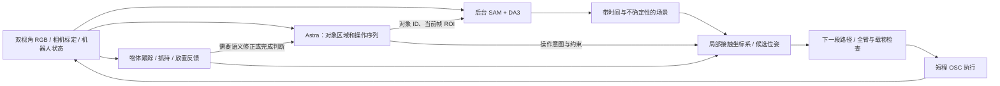

# foundation_vision_harness_V1

这是面向首次综合任务 rollout 的独立实现。入口为
`scripts/evaluate_foundation_vision_harness_V1.py`，代码位于
`src/gpt_field/foundation_vision_harness_V1/`。旧 harness 和历史实验保持原样。

本版落实讨论中的最小完整闭环，采用 Astra high 订阅、SAM 3.1、DA3 和已有
Panda OSC 控制器。没有任务专用坐标、演示轨迹或按 benchmark 名称分支的操作技能。
它没有实现两份长期计划中的全部里程碑、共享内存传输或训练项目。

## 数据流与模块



| 文件 | 已实现职责 |
|---|---|
| `client.py` | 首次请求合并场景清单、像素区域和操作序列；当前双视图加紧凑历史；拒绝 evaluator 输入 |
| `scene.py` | 常驻后台视觉线程，待处理队列只保留最新帧；区域追踪与重关联；机器人自身表面过滤；保留单视角几何及带日期的遮挡记忆 |
| `geometry.py` | 根据选中的材料区域、工具尺寸、支撑面和载物形状生成接近、夹持、搬运、放置及退出候选 |
| `motion.py` | 候选路径、绕行、已有冲突的非加深退出；基于实际关节和速度预测短程 OSC；全臂、自碰撞和载物检查 |
| `feedback.py` | RGB LK/PnP 材料跟踪；整个物体的观测外形随夹爪附着；共同运动、滑落和释放证据 |
| `executor.py` | 操作状态机、局部对准、实际闭爪计数、抓持确认、连续执行、有限恢复及 `finish/blocked` |
| `runner.py` | 一次独立 episode；自主结束与外部评分分离；停止请求；真实墙钟计时 |
| `recording.py` | 有界异步视频队列；双视图、预测障碍、关键位姿和实际路径；记录丢帧及采集时间 |

## Astra 输出什么

一次响应可包含多个通用操作，不固定为三个目标：
`pick_place / grasp / place / move / contact_move / release / observe`。
每个对象有稳定 ID、简短查询、角色、父对象及当前帧中的像素框。
抓取必须明确选择物体上的材料区域，例如某段可见边缘，而不是仅给整个物体中心。

操作字段包括 `object`、`target`、`grasp_region`、`relation`、`keep_upright`、
接近方向、夹爪方向、接触部位和相对运动。没有绝对 XYZ 或四元数目标字段。
`on/inside/beside` 由观察到的支撑几何落地；`beside` 还需要侧向偏好和支撑区域。
关节物体采用同一批次的 `grasp → contact_move`，不会把整台柜子当载物提起。

模型响应后的 ROI 先在请求对应的原始图像上解析。执行器随后发出一次保持动作，
取得新观测并刷新场景，再开始任务运动；不会把几十秒前的图像重新标记为新帧。

## 如何执行

典型 `pick_place` 在本地推进：

```text
approach → align → close → lift → hold_check
         → transport → preplace → place → release → retreat → release_check
```

只求解下一阶段；尚未看清最终放置区域，不阻止有用的接近。接触区域未解析时允许
向可见物体的观察位置接近，但不会以整个物体中心代替接触点自动闭爪。
选定的候选位姿在滚动重规划中保持一致，相对位移不会每一步重新累加。

短程控制读取实际七个关节、关节速度和末端状态。运动预测有在线残差带，
检查手臂、手掌、手指及载物。接触许可限定在指定对象和指定机器人部位；
载物内部的其他对象仍保留为障碍。

闭爪后先保留整个物体的观测外形，提起时通过材料跟踪或新场景中的共同运动确认
抓持。没有足够载物外形时不进入搬运。释放后检查物体与退出的手分离，并检查
请求的支撑关系。上述都是视觉/几何证据，不冒充物理接触传感器。

视觉默认每 10 个实际机器人步骤考虑刷新，最短提交间隔 0.5 秒；关键阶段可主动
等待新结果。等待中的帧合并，不积压过时作业。单视角几何保留为有不确定性的
证据，不再因双向 mask 匹配未达 90% 而清空整个目标。遮挡记忆可用于障碍判断，
不能用于证明刚刚抓住或放下物体。

局部路径拒绝允许一次新观察重规划；相同问题仍存在则进入 `blocked`。
语义上可修正的问题交回 Astra，并记住失败操作，避免原样重复。
没有 episode 总时长、总动作数或总调用数上限；局部阶段具有进展和动作预算。

## 结束、计时与视频

策略只能依据公共观测输出 `finish/blocked`。raw LIBERO success 首次出现会记录，
不会使控制提前结束。策略声明完成后，评分侧读取终态，并用相同夹爪命令保持位姿
10 步检查稳定性；这些状态不回流给策略，也不自动张爪修正结果。

`strict_success` 要求自主 `finish`，且终态及保持后的 raw/strict 条件均成立。
单独报告 raw 首次达到、终态 raw、终态 strict、保持后结果；未完成时间不称为
完成延迟。`online_wall_s` 包含在线模型等待、感知等待、控制、IPC、日志与视频
入队开销，不扣减视频耗时。`completion_wall_s` 仅在严格成功时给出，覆盖从
在线开始到评分保持结束的实际墙钟间隔。模型预加载、启动和后处理另外记录。

视频绘制和编码在后台，队列满时丢弃中间采样帧。播放时长不等于任务墙钟；
事件索引保存采集时间。图中几何均为预测观测，颜色不代表无碰撞证明。

## 首次 T04 can obstacle 命令

下面使用前一轮同一份障碍任务和初始状态。任务句子仍由现有公开任务配置提供；
BDDL、物体真值和 evaluator 接触不进入策略。命令中的文件是已有实验输入，
不会覆盖旧结果。正式运行前需要用户批准。

```bash
PYTHONPATH=src .venv-foundation-vision/bin/python \
  scripts/evaluate_foundation_vision_harness_V1.py run --approved \
  --task libero_10_t4 --episode-index 0 \
  --output runs/foundation_vision_harness_V1_t04_can_obstacle_001 \
  --sam-checkpoint artifacts/foundation_vision/models/sam3.1/sam3.1_multiplex.pt \
  --da3-model artifacts/foundation_vision/models/models--depth-anything--DA3-LARGE-1.1/snapshots/0e109ae307c5982f319a67cf6f9f99ccdc0ec97c \
  --task-bddl-override output/foundation_harness_preparation_001/inputs/custom_task.bddl \
  --initial-state-override output/foundation_harness_preparation_001/inputs/initial_state.npy \
  --expected-initial-observation-sha256 06f623f31ee2ea2e8ef600ce29d299413d81a8647d8f59663f3aff2e660da187 \
  --store-dir .private/chatgpt_plan
```

将 `run --approved` 改成 `inspect` 可仅读取本地配置，不加载权重、不调用模型、
不启动模拟器。权重设备可以用 `--vision-device` 指定；正式启动时需按当时资源
选择 GPU。runner 不自动重试或启动其他任务。

运行根目录保存配置、代码快照、模型加载时间、输入摘要和最终 `result.json`。
`trial/run_state.json` 显示进度；`trial/trace.jsonl` 记录动作和独立评分；
`trial/foundation_vision_harness_V1/events.jsonl` 记录各阶段、故障和反馈；
`trial/episode.mp4` 为异步可视化。创建
`trial/operator_stop.request.json` 可请求在下一个完整边界停止；模型等待期间
发出的停止请求会阻止返回动作下发。

## 当前范围与待测项

本次实施只进行 CPU 检查与保存数据分析，没有授权新的完整任务。
检查覆盖协议、异步时序、区域来源、接触/载物几何、执行闭环和独立结束评分。
保存数据及合成测试不能证明真实抓持成功、OOD 泛化或三分钟达标。

2026-11-09 的针对性检查共 40 项通过：client 11、scene 5、motion 12、
executor 6、runner 6。第一次合并检查的 6 个失败来自 executor 测试夹具，
修正为有效双相机和正确的观测接收顺序后，受影响的 6 项通过；原日志保留。
随后修正释放阶段的接触权限，并只运行新增的相关回归。记录位于
`output/foundation_vision_harness_V1_preparation_001/`，没有反复运行全库测试。

额外使用旧 T04 第 210 步的公共观测、预测深度、保存的 SAM masks 和当时 Astra
给出的把手 ROI 做了一次静态几何接入检查。它得到 50 个把手点，但接近路径仍
受阻：旧归档没有新版机器人查询的 SAM masks，机器人附近的未分类预测点仍与
整臂包络重叠，40 次配置预算内未找到路径。场景处理约 2.59 秒、规划约 1.79 秒。
该结果保留在 `public_replay.json`，不能称为接近成功，也不能证明新机器人分割
已经解决阻塞；需要下一次获批 rollout 的完整感知输出来判断。

本版仍复用现有 PNG/JSON 模拟器传输和公共标定适配器，尚未实现 FrameRing。
视觉工作线程与控制共用一个 Python 进程；它避免同步等待每一步 SAM/DA3，
但不是进程级资源隔离。几何不确定性目前是配置与观测估计，尚未经过误差覆盖率
标定；短程 OSC 预测和有限碰撞采样不是连续无碰撞证书。局部路径搜索有预算，
并非完备规划器。载物采用膨胀的可见外形包围体，孔洞和把手附近可能过于保守。
第一轮应直接观察任务完成、调用数、阶段耗时、拒绝原因及实际
接触，再决定优化哪一项。
