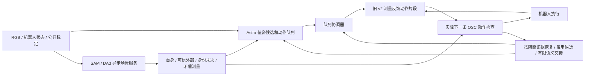

# foundation_vision_harness_V2

本版把 Astra 的位姿候选接回旧 v2 的测量反馈执行器。当前修订为 `evidence_recovery_r3`：修正 T04 第 002 轮暴露的障碍证据准入、重复恢复和感知双重等待。第 002 轮已由用户停止，在线 1053.18 秒、176 步、37 次模型请求，未抓取；[分析报告](runs/foundation_vision_harness_V2_t04_can_obstacle_002/REPORT.md)与旧归档保留原样。r3 尚未运行完整任务，等待用户批准第 003 轮。

## 控制链



- Astra 一次可给 1–24 段动作，每段 1–3 个候选。选择接触区域、接近方向、夹爪朝向、位姿和备用策略；动作 ID、来源帧 ID、执行预算和接触部件默认值由 harness 补齐。张爪/闭合候选仅需 `skill=open/close`。
- 位姿是世界坐标的 `grip_site xyz_m` 和 `right_hand quaternion_wxyz`。相对位移在该段进入时解析一次。具有显式接触 grounding 的绝对位姿可以使用 `xyz_m=null`，由测量生成位置。
- `grounding` 指定当前图像中的材料点：`region, view, pixel, offset_hand_m, standoff_m, reference`。局部 mask 和预测深度将该点换算到世界坐标，随后按 `目标位置 = 材料点 − R×接触偏移 − R[:,2]×接近距离` 计算夹爪目标，保持 Astra 的朝向。若另有名义 XYZ，则最多修正 5 cm；更大差异返回测量证据供语义修复。null XYZ 不需要先伪造名义位置。
- 新帧用局部材料对应更新像素，不按整个物体中心位移代替材料点。放置的 `payload_support` 使用实际载物可见底部支撑区域，`offset_hand_m` 填零。来源、身份或深度冲突返回具体原因。未提供 grounding 的旧式绝对位姿仍只有目标位移补偿（3 cm 上限），不能宣称已修正初始定位误差。
- `MeasuredFragment` 复用 `FragmentSequencePrimitive` 的到位判断、夹爪稳定和实际停滞反馈，不加载旧 Agent 的宏动作或模型调度。动作经局部缩短或改变后，片段收到的反馈对应实际下发动作。
- 完成一段后本地进入下一段。`observe` checkpoint 不自动请求 Astra；`held` / `released` 在模型安排的抬升、退出之后使用共运动或分离证据。证据不足返回语义层，不当作已抓牢或必然失败。协调器不插入自动探测动作。

首个 Astra 请求仍与后台视觉并行。对象尚未命名时不声称已有目标几何；Astra 可以在同次响应中给出对象区域、材料像素和动作。依赖新材料区域的候选仍须绑定原始帧 ROI；普通自由移动不因模型返回而默认等待源图与新帧两次感知，不增加专门的初始定位模型请求。

## 场景与动作约束

`scene.py` 复用常驻异步 worker、区域关联和观测记忆。重复处理同一来源帧时复用 DA3 和几何；新增查询只补做相应 SAM 查询。默认每 10 步允许后台刷新，最小提交间隔 0.5 秒。新 ROI 保持原始帧来源；普通动作通过后台更新获取场景，需要新接触证据或场景过期时才同步等待。

场景分成四类：

| 类别 | 依据 | 控制作用 |
| --- | --- | --- |
| 自身 | 捕获时的关节状态、机器人模型、相机射线及深度关系 | 从环境障碍图分离；机器人仍参与自碰撞检查 |
| 外部 | 通过测量质量准入的具名或匿名外部表面；不强制所有表面双视角可见 | 参与实际下一条动作的机器人和载物检查 |
| 未决 | 几何仍可信，但 robot 标签、投影身份等不能确定 | 局部评估运动是否接近或进入；可缩短动作或重新观察 |
| 矛盾测量（disputed） | 跨视角反驳、缺乏独立支持的边缘或深度跳变测量 | 保存来源和拒绝原因，不放进 external 或 unresolved 的实体碰撞树 |

SAM 的 robot 标签不能单独删除前景。具名对象也不能绕过测量冲突检查。体素合并保持测量资格和来源差异，避免坏点混入可信代表点；保留的旧表面重新按当前可信射线处理，坏射线也不能清空旧障碍。位置误差、点云表示半径和身份未决分别记录。归档保存原始预测深度、候选 mask、点源索引和 disputed 来源。丢弃一条坏测量不等于宣布其后的未知空间为空闲，也不提供完整占据图或连续碰撞保证。

`motion.py` 复用机器人几何和短时 OSC 预测，不调用 V1 的整段 IK 路径准入。每次检查实际准备发送的动作，包括全机械臂、自碰撞、夹爪扫掠和已观测载物。模型指定的目标接触权限按对象和接触部件限定；载物接触支撑面还要求局部支撑平面。

候选动作可缩短、拆分转动/平移或尝试两个短切向方向。周围存在未决观测时，单次平移缩至最多 5 mm、转动最多 0.03 rad；实际关节响应与预测不符也先缩短。已有环境重叠可以沿不加深重叠的方向退出，自碰撞和关节限制不获得该豁免。只有实际派发并收到匹配反馈的动作才更新响应模型。

这些是基于预测几何的局部检查，不提供连续碰撞保证，也尚未证明三分钟完成任务。

## 恢复与结束

首条动作被拒绝和执行中受阻使用同一恢复入口：围绕阻挡部位、物体/空间位置和局部机器人状态刷新一次 → 重试/备用候选 → 有限语义交接。恢复身份不再依赖完整候选 JSON、目标中心或帧号；只改动作偏移或重写 ROI 不会把同一阻断变成新问题。再次遇到未改变的阻断会明确以 `blocked` 结束；实际位姿或阻挡证据改变仍允许继续。这是局部恢复结束条件，不是整回合时间或请求上限。

checkpoint 的检查对象与接触对象独立：wire 使用 `checkpoint={state,object}`，内部规范化为 `checkpoint` 和 `checkpoint_object`。检查对象可从唯一明确的前序抓取/释放，或当前实际 held/released 记录继承。自由退出允许接触对象为空，但执行 checkpoint 时必须匹配实际检查对象。

完整响应若存在无法解析的协议错误，保留有界的原提议与具体错误，交回 Astra 修复；无效批次的任何前缀都不执行。robot→已知 robot 的无环冗余 `parent_id` 在本地规范化为空，不再为此请求模型；真正的 region 父级、目标身份和接触权限继续校验。同一未变化状态下再次无法修复时以明确 `blocked` 结束。网络故障仍不自动重试，也没有 API-key fallback。

闭合时载物几何缺失，重新观察到完整对象的可见几何后会更新候选载物形状，不能仅更新场景却永久保留缺失标记。该更新不构成抓持成功证据。形状仍未知时，允许 Astra 明确要求的原地张爪恢复；搬运仍需重新观察。

Runner 保留 V1 的自主 `finish/blocked`、独立 raw/strict 评分和异步录像。评估器成功不进入策略、不提前停止策略；结束后的独立检查保持原夹爪指令，不替模型松手。在线时间为实际墙钟时间，包含感知等待、日志和录像提交开销。没有整回合时间、动作或请求上限；3 分钟是目标，不是截断规则。

每次模型请求在 `finally` 中计时，包括协议失败；同时记录首个可见输出、输出过程和完整请求耗时。每条实际动作记录位移/转角、局部目标距离变化及决策、过滤、模拟器、反馈、录像提交耗时；过滤器分别统计接受/拒绝耗时及 p50/p95。记录机械臂运动和接近局部目标的程度，不将它们当作任务成功。计时项存在包含关系，不能直接相加。

## 文件

- `src/gpt_field/foundation_vision_harness_V2/client.py`、`protocol.py`：订阅客户端、紧凑协议、默认值/引用规范化和精简历史。
- `executor.py`：队列、测量反馈片段、checkpoint 和恢复。
- `grounding.py`：材料像素、局部深度、材料对应和接触位置校正。
- `scene.py`：视觉缓存、类型化场景和来源归档。
- `motion.py`：实际下一条 OSC 动作检查。
- `runner.py`、`recording.py`、`telemetry.py`：独立任务循环、异步录像、逐步耗时和测量进展。
- `scripts/evaluate_foundation_vision_harness_V2.py`：独立启动入口。

原 speedup v2、foundation vision 和 V1 源文件未改写。本版没有任务专用技能、benchmark 坐标或新的训练权重。

## 历史 r2 准备证据

修订准备位于 `output/foundation_vision_harness_V2_revision_002/`。原失败的 12 段响应可完整规范化：最后的自由退出保持 `object=null`，检查对象继承为白杯。紧凑输出从 5331 缩至 4348 字节（18.44%）；提示从 5711 缩至 4665 字节（18.32%）。这些是字节代理，不是实测模型延迟。

针对性 CPU 检查覆盖失败请求计时与语义修复、检查对象匹配、静止目标 2 cm 初始误差校正、材料点跟踪、null XYZ 到真实测量片段的连接、载物支撑位置及逐步耗时。修订阶段没有调用实时模型、视觉模型或模拟器。记录见该准备目录的 `implementation_validation.json`。此前第 001 轮原始报告位于 `runs/foundation_vision_harness_V2_t04_can_obstacle_001/REPORT.md`。

保存点云诊断使用最近 V1 T04 失败帧：23,947 点中 22,985 个外部点全部保留，962 个 robot 相关残留点转为独立未决观测，未直接删除。V1 归档缺少原始深度、mask 和点源索引，无法完整重放新视觉分类。

在保留旧归档数值余量的单条动作诊断中，动作仍被手部附近的匿名表面拒绝，检查耗时约 0.583 秒；没有调用整段路径规划，也没有执行动作。这说明“仅分离有 robot 标签的点”不足以证明问题已解决。新射线分类、Astra 候选、实际反馈恢复及整体速度，仍需要获批后的正式任务检验。详见准备目录中的 `saved_scene_diagnostic.json` 和 `saved_command_diagnostic.json`。

## r3 准备与待批准测试

修订准备位于 `output/foundation_vision_harness_V2_revision_003/`。本次只做相关 CPU 合约检查，没有调用实时模型、视觉模型或模拟器。新实现是否减少阻断、缩短实际任务耗时，仍需用户批准后的完整任务检验。

## 获批后的修订版 T04 命令（第 003 轮，尚未运行）

沿用 T04 can obstacle 的 init 0、seed 7、固定初始观测和 Astra high 订阅。CLI 默认使用旧成功执行配置的 0.10 m transit 指令上限，实际动作仍经过局部检查。启动前按当时资源情况选择 GPU。

```bash
PYTHONPATH=src GPT_FIELD_USER_CHECK_TRANSIT_ACTION_M=0.10 \
  .venv-foundation-vision/bin/python scripts/evaluate_foundation_vision_harness_V2.py run --approved \
  --task libero_10_t4 --episode-index 0 \
  --output runs/foundation_vision_harness_V2_t04_can_obstacle_003 \
  --sam-checkpoint artifacts/foundation_vision/models/sam3.1/sam3.1_multiplex.pt \
  --da3-model artifacts/foundation_vision/models/models--depth-anything--DA3-LARGE-1.1/snapshots/0e109ae307c5982f319a67cf6f9f99ccdc0ec97c \
  --task-bddl-override output/foundation_harness_preparation_001/inputs/custom_task.bddl \
  --initial-state-override output/foundation_harness_preparation_001/inputs/initial_state.npy \
  --expected-initial-observation-sha256 06f623f31ee2ea2e8ef600ce29d299413d81a8647d8f59663f3aff2e660da187 \
  --store-dir .private/chatgpt_plan
```

`run --approved` 只可在用户批准该次完整任务后使用。停止文件为该次 `trial/operator_stop.request.json`。没有自动重试或后续任务队列。
